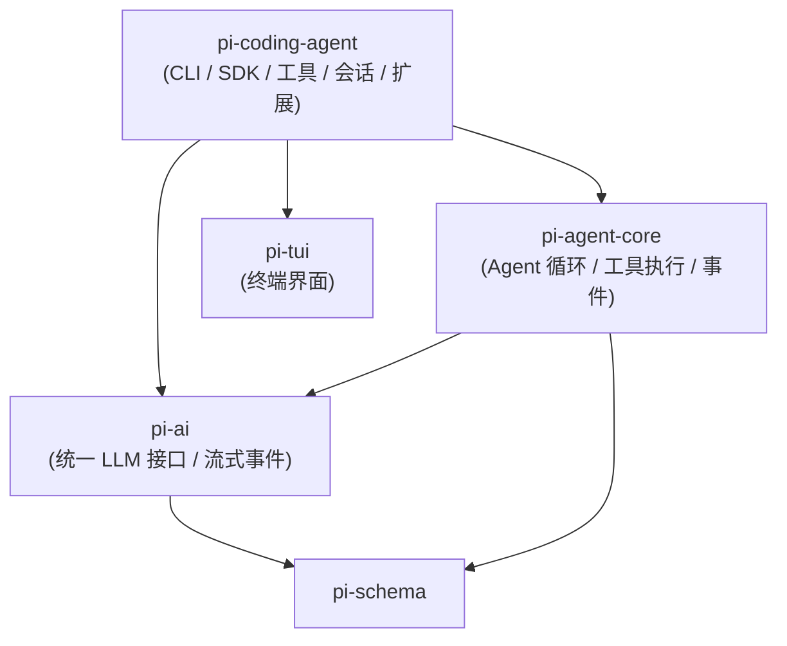
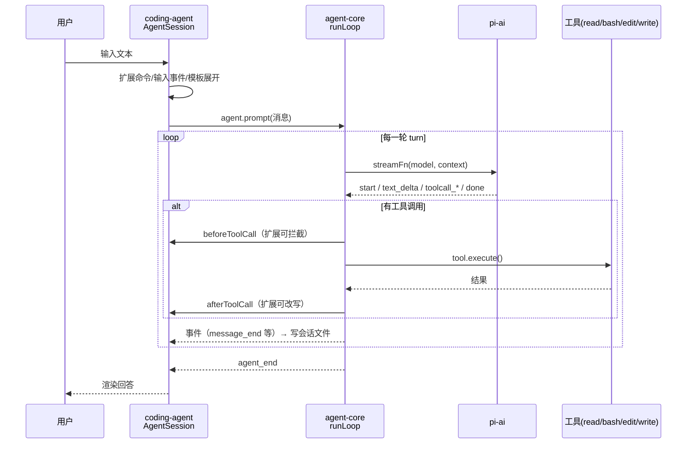

> 本系列基于 [earendil-works/pi](https://github.com/earendil-works/pi)（MIT 许可，原 `badlogic/pi-mono`）**commit `a758f3a`（2026-11-03 读取）**。文中所有代码摘录均来自该 commit，版权归原作者，按 MIT 许可引用；为便于讲解做了删减，删减处用 `// ...` 标出。项目更新很快，你读到时代码可能已变化，请以链接里的固定 commit 为准。

**本篇重点**：先搞清楚 Pi 是什么、仓库里每个包干什么、谁依赖谁，然后跟着一条用户消息，从你敲下回车一路走到模型回答、工具执行、写进会话文件。后面五篇会分别钻进每一层。

<!-- more -->

## 先纠正一个名字

你听到的「PiAgent / PyAgent」，指的应该是 **Pi**：一个用 **TypeScript** 写的开源 Agent 框架（不是 Python）。它的 README 第一句话是：

> Pi is a minimal, extensible agent harness that you can make your own.

意思是「一个极简、可扩展、可以改造成你自己的 Agent 外壳（harness）」。它自带一个命令行编程助手 `pi`（类似 Claude Code 那一类工具），但更重要的是：它把「调大模型」「Agent 循环」「编程助手」拆成了几个独立的 npm 包，每一层都能单独拿来用。这正是它适合拿来学习 Agent 原理的原因：**层次清楚、核心循环代码量小**（`agent-loop.ts` 不到 1000 行）。

README 里还明确说了它**刻意不内置**子 Agent（sub-agents）和计划模式（plan mode），想要可以自己用扩展做。这一点面试时可以拿来讲「极简内核 + 扩展」的设计哲学。

## 人话直觉：三层蛋糕

把 Pi 想成三层蛋糕：

1. **最底层 pi-ai**：「万能插座」。不管你接的是 OpenAI、Anthropic、Google 还是本地 Ollama，它都把请求和流式返回统一成同一套消息格式和事件。
2. **中间层 pi-agent-core**：「发动机」。就是那个经典 Agent 循环：问模型 → 模型要调工具 → 执行工具 → 把结果塞回去 → 再问模型……直到模型不再调工具。
3. **最上层 pi-coding-agent**：「整车」。给发动机装上读写文件、跑命令的工具，拼好系统提示词，把对话存成文件，支持扩展插件，再提供终端界面、命令行、RPC、SDK 等多种用法。

另外 **pi-tui** 是一个终端界面库（README 描述为 "Terminal User Interface library with differential rendering"，即差量渲染的终端 UI），只负责「画界面」，不参与 Agent 逻辑。

## 源码走读：仓库结构

仓库根目录 `package.json` 用 npm workspaces 管理 `packages/*`。在这个 commit 下 `packages/` 里有：

```text
agent  ai  chord  codemode  coding-agent  durable  env  evals  mcp  schema  telemetry  tui
```

本系列只精读与 Agent 主链路直接相关的四个（其余如 `mcp`、`codemode`、`schema` 只在用到时顺带提及）：

| 目录 | npm 包名 | package.json 里的 description |
|---|---|---|
| `packages/ai` | `@earendil-works/pi-ai` | Unified LLM API with automatic model discovery and provider configuration |
| `packages/agent` | `@earendil-works/pi-agent-core` | General-purpose agent with transport abstraction, state management, and attachment support |
| `packages/coding-agent` | `@earendil-works/pi-coding-agent` | Coding agent CLI with read, bash, edit, write tools and session management |
| `packages/tui` | `@earendil-works/pi-tui` | Terminal User Interface library with differential rendering … |

### 包依赖关系（从各包 package.json 读出）

- `pi-ai` 依赖 `pi-schema`、`pi-telemetry`
- `pi-agent-core` 依赖 `pi-ai`、`pi-schema`
- `pi-coding-agent` 依赖 `pi-agent-core`、`pi-ai`、`pi-tui`、`pi-mcp`、`pi-codemode`

根 `package.json` 的 `build` 脚本也印证了顺序：先 `telemetry → schema → … → tui → … → ai → … → agent → coding-agent`，底层先编译，上层后编译。



**一个关键设计**：`pi-agent-core` 并不直接依赖任何具体厂商。它在 [`packages/agent/src/stream-fn.ts`](https://github.com/earendil-works/pi/blob/a758f3ae4cdb193a6949c81318fe1b3caa4814a1/packages/agent/src/stream-fn.ts) 里只留了一个「插槽」：

```ts
let defaultStreamFn: StreamFn | undefined;

/**
 * Hosts that provide a default model runtime can install its stream function here
 * without making pi-agent-core depend on a provider catalog or compatibility layer.
 */
export function setDefaultStreamFn(streamFn: StreamFn | undefined): void {
	defaultStreamFn = streamFn;
}
```

逐行讲：

- 第 1 行：模块级变量，存「怎么调用模型」的那个函数。
- 注释说得很直白：宿主（比如 coding-agent）可以把自己的调用函数装进来，**这样 agent-core 就不必依赖厂商目录**。
- 所以 agent-core 只认一个函数签名 `StreamFn`（下一节和第 3 篇细讲），谁实现它都行——这就是依赖倒置。

## 全链路：一条消息的旅程

下面这条链路是我按源码调用关系整理的。每一步后面标了文件，后续篇章会逐个展开。

**① 启动与模式选择**——[`coding-agent/src/main.ts` L112-123](https://github.com/earendil-works/pi/blob/a758f3ae4cdb193a6949c81318fe1b3caa4814a1/packages/coding-agent/src/main.ts#L112-L123)：

```ts
function resolveAppMode(parsed: Args, stdinIsTTY: boolean, stdoutIsTTY: boolean): AppMode {
	if (parsed.mode === "rpc") {
		return "rpc";
	}
	if (parsed.mode === "json") {
		return "json";
	}
	if (parsed.print || !stdinIsTTY || !stdoutIsTTY) {
		return "print";
	}
	return "interactive";
}
```

- 显式 `--mode rpc` / `--mode json` 优先。
- 加了 `-p/--print`，**或者标准输入/输出不是终端**（比如被管道接走），就进 print 模式。
- 否则才是交互式终端界面。这就是为什么 `echo "hi" | pi` 会自动变成非交互。

**② 用户输入预处理**——`AgentSession.prompt()`（[`core/agent-session.ts` L2113 起](https://github.com/earendil-works/pi/blob/a758f3ae4cdb193a6949c81318fe1b3caa4814a1/packages/coding-agent/src/core/agent-session.ts#L2113)），按源码顺序：

1. 如果以 `/` 开头，先看是不是扩展注册的命令（`_tryExecuteExtensionCommand`），是就直接执行，不发给模型；
2. 触发扩展的 `input` 事件（扩展可以改写或吞掉输入）；
3. 展开 `/skill:名字`（`_expandSkillCommand`）和提示模板（`expandPromptTemplate`）；
4. 如果 Agent 正在跑，必须指定 `streamingBehavior` 为 `steer` 或 `followUp`，消息进队列；
5. 检查有没有选模型、有没有配置认证；
6. `_startRun(...)` 真正开跑。

**③ Agent 循环**——`pi-agent-core` 的 `Agent.prompt()` → `runAgentLoop()` → `runLoop()`（[`agent/src/agent-loop.ts`](https://github.com/earendil-works/pi/blob/a758f3ae4cdb193a6949c81318fe1b3caa4814a1/packages/agent/src/agent-loop.ts)）。每一轮（turn）：转换消息 → 调模型（流式）→ 如果有工具调用就执行 → 把工具结果加入上下文 → 再来一轮。

**④ 调用模型**——循环通过 `StreamFn` 调到 `pi-ai`，`pi-ai` 根据模型的 `api` 字段（如 `"anthropic-messages"`、`"openai-responses"`）找到对应实现，并**按需动态 import** 该实现模块（`api/lazy.ts` 里的 `lazyApi`），把厂商的 SSE/WebSocket 流翻译成统一的 `AssistantMessageEvent`。

**⑤ 执行工具**——模型返回 `toolCall` 后，循环查找同名工具 → 校验参数（`validateToolArguments`）→ 调 `beforeToolCall` 钩子（coding-agent 在这里接上扩展的 `tool_call` 事件，可拦截）→ `tool.execute()` → `afterToolCall` 钩子（接扩展的 `tool_result` 事件）→ 生成 `toolResult` 消息。

**⑥ 持久化与压缩**——coding-agent 订阅 Agent 事件，把消息写成 JSONL 会话文件（`core/session-manager.ts`）；在两轮之间（`prepareNextTurn`）检查上下文是否快满，满了就做压缩（`core/compaction/`）。

**⑦ 渲染输出**——交互模式由 TUI 组件渲染事件；print 模式输出最终回答；json 模式把事件逐行输出成 JSONL；rpc 模式通过 stdin/stdout 收发 JSONL。



## 设计取舍

- **分层 vs 一体化**：拆成多个包，好处是你可以只用 `pi-ai` 做多厂商调用，或只用 `pi-agent-core` 搭自己的 Agent；代价是概念多、类型层层包装，新手第一次读会觉得绕。
- **极简内核**：子 Agent、计划模式都不内置，交给扩展。好处是核心稳定、好懂；代价是开箱功能比某些「大而全」框架少。
- **TypeScript**：类型系统把消息、事件都写成了可辨识联合类型（discriminated union），读类型定义就能读懂协议——这是读这个项目的最佳入口。

## 常见误区

- ❌「Pi 是 Python 框架」——是 TypeScript monorepo，跑在 Node.js / Bun 上。
- ❌「agent-core 里写死了 OpenAI」——agent-core 只依赖一个 `StreamFn` 函数签名，具体厂商在 pi-ai。
- ❌「Agent 就是一次模型调用」——一次用户输入可能触发多轮（turn）模型调用，直到模型不再请求工具。

## 面试问答

1. **问：一个 Agent 框架通常分哪几层？用 Pi 举例。**
   答：模型接入层（pi-ai，统一多厂商接口与流式事件）、Agent 运行时（pi-agent-core，循环、工具执行、事件）、应用层（pi-coding-agent，具体工具、提示词、会话、扩展、界面）。
2. **问：为什么 agent-core 不直接依赖模型厂商？**
   答：通过 `StreamFn` 依赖倒置，核心只依赖抽象函数签名，便于替换厂商、写测试（可以注入假的流）、在浏览器或代理服务器等不同环境运行。
3. **问：一次用户输入，Agent 会调用几次模型？**
   答：不确定。每轮模型若返回工具调用，执行后要再调一次；直到某轮没有工具调用（且没有排队消息）才结束。
4. **问：Pi 的 CLI 什么时候进入非交互模式？**
   答：`resolveAppMode` 中，`--print` 或 stdin/stdout 不是 TTY 时进 print；`--mode json`/`--mode rpc` 显式指定。
5. **问：用户输入到模型之前会经过哪些处理？**
   答：扩展命令、`input` 事件、skill 命令与提示模板展开、运行中排队（steer/followUp）、模型与认证校验。
6. **问：什么是 harness？**
   答：围绕模型的「外壳」：负责循环、工具、上下文、存储和界面，模型本身只负责生成。

## 自测题

1. Pi 的三个核心包从底到顶是？
2. `echo "列出文件" | pi` 会进入哪种模式？为什么？
3. 「工具调用能被扩展拦截」是在哪一层接上的？

<details><summary>答案</summary>

1. pi-ai → pi-agent-core → pi-coding-agent。
2. print 模式，因为 stdin 不是 TTY（`resolveAppMode` 的 `!stdinIsTTY` 分支）。
3. agent-core 提供 `beforeToolCall` 钩子，coding-agent 的 `AgentSession` 把它接到扩展的 `tool_call` 事件上（第 5 篇详讲）。
</details>

## 参考资料

- Pi 仓库 README（commit a758f3a）：https://github.com/earendil-works/pi/blob/a758f3ae4cdb193a6949c81318fe1b3caa4814a1/README.md
- How Pi Works（仓库内文档）：https://github.com/earendil-works/pi/blob/a758f3ae4cdb193a6949c81318fe1b3caa4814a1/packages/coding-agent/docs/how-pi-works.md
- `main.ts`、`agent-session.ts`、`stream-fn.ts` 源码：见文中链接
- 本博客：[AI Agent 与工具调用：ReAct、Function Calling、MCP 入门](/2026/10/29/ai-agent-tool-calling/)

**系列目录**：[（一）总览](/2026/11/03/pi-source-01-overview/) · [（二）pi-ai](/2026/11/03/pi-source-02-pi-ai/) · [（三）Agent 主循环](/2026/11/03/pi-source-03-agent-loop/) · [（四）编程助手工具与会话](/2026/11/03/pi-source-04-coding-agent/) · [（五）扩展与运行模式](/2026/11/03/pi-source-05-extensions-modes/) · [（六）动手写最小 Agent](/2026/11/03/pi-source-06-hands-on/)
