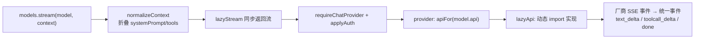

> 基于 [earendil-works/pi](https://github.com/earendil-works/pi) **commit `a758f3a`（2026-11-03 读取）**，代码摘录按 MIT 许可引用，有删减。

**本篇重点**：pi-ai 怎么把 OpenAI、Anthropic、Google 等众多厂商「抹平」成一套接口？核心就三样东西：**统一的消息类型**、**统一的流式事件协议**、**按 `api` 字段分发的 Provider**。

<!-- more -->

## 人话直觉

每家模型厂商的 API 长得都不一样：Anthropic 叫 `content_block_delta`、`tool_use`，OpenAI 有 Chat Completions 和 Responses 两套格式，停止原因的名字也各不相同。如果 Agent 循环直接对接它们，就会写满 `if (厂商 === ...)`。

pi-ai 的做法像「翻译官」：
- 对上（Agent）只说一种「普通话」：`Message` 消息类型 + `AssistantMessageEvent` 事件；
- 对下（厂商）每种 API 写一个翻译模块，放在 `packages/ai/src/api/` 下，例如 `anthropic-messages.ts`、`openai-completions.ts`、`openai-responses.ts`、`google-generative-ai.ts`、`bedrock-converse-stream.ts`。

注意「API」和「厂商（provider）」是两个概念：很多厂商兼容 OpenAI 格式，所以**一个 API 实现可以服务很多厂商**。README 也写了支持 "Any OpenAI-compatible API: Ollama, vLLM, LM Studio, etc."。

## 源码走读 1：消息类型

文件：[`packages/ai/src/types.ts`](https://github.com/earendil-works/pi/blob/a758f3ae4cdb193a6949c81318fe1b3caa4814a1/packages/ai/src/types.ts)

### 四种角色

```ts
export type Message = SystemMessage | UserMessage | AssistantMessage | ToolResultMessage;
```

（[L666](https://github.com/earendil-works/pi/blob/a758f3ae4cdb193a6949c81318fe1b3caa4814a1/packages/ai/src/types.ts#L666)）消息只有 4 种 `role`：`system`、`user`、`assistant`、`toolResult`。这是一个**可辨识联合**：用 `role` 字段就能让 TypeScript 自动收窄类型。

### 助手消息的内容块

```ts
export interface AssistantMessage {
	role: "assistant";
	content: (TextContent | ThinkingContent | ToolCall)[];
	api: Api;
	provider: ProviderId;
	model: string;
	// ...
	usage: Usage;
	stopReason: StopReason;
	errorMessage?: string;
	timestamp: number;
	// ...
}
```

（[L592 起](https://github.com/earendil-works/pi/blob/a758f3ae4cdb193a6949c81318fe1b3caa4814a1/packages/ai/src/types.ts#L592)）逐行讲：

- `content` 是**数组**，一条回复里可以同时有：普通文本 `text`、推理过程 `thinking`、工具调用 `toolCall`。比如「我先读一下文件」+ 一个 `read` 调用。
- `api / provider / model`：记录这条消息是谁生成的。后面「跨厂商切换」要靠它判断。
- `usage`：token 用量和费用。
- `stopReason`：为什么停下。
- 出错时不抛异常，而是 `stopReason` 为 `"error"`/`"aborted"` 并带 `errorMessage`——**错误也是一条消息**，这个设计后面会反复出现。

### 工具调用块

```ts
export interface ToolCall {
	type: "toolCall";
	id: string;
	name: string;
	arguments: JsonObject;
	// ...
	argumentsError?: string;
}
```

（[L451 起](https://github.com/earendil-works/pi/blob/a758f3ae4cdb193a6949c81318fe1b3caa4814a1/packages/ai/src/types.ts#L451)）
- `id`：工具结果要用 `toolCallId` 对回这个 id，模型才知道哪个结果对应哪次调用。
- `arguments`：已经解析好的 JSON 对象（不是字符串）。
- `argumentsError`：源码注释说，模型发来的参数文本不是合法 JSON 对象时，`arguments` 会是 `{}`，这里写明问题，之后参数校验会因此失败。

### 停止原因

```ts
export type StopReason = "pending" | "stop" | "length" | "toolUse" | "error" | "aborted" | "deferred";
```

（[L496](https://github.com/earendil-works/pi/blob/a758f3ae4cdb193a6949c81318fe1b3caa4814a1/packages/ai/src/types.ts#L496)）最常用的：`stop` 正常结束、`length` 被输出 token 上限截断、`toolUse` 要调工具、`error`、`aborted` 被用户取消。

看各厂商怎么翻译成它——Anthropic 的 `mapStopReason`（[`api/anthropic-messages.ts` L1934 起](https://github.com/earendil-works/pi/blob/a758f3ae4cdb193a6949c81318fe1b3caa4814a1/packages/ai/src/api/anthropic-messages.ts#L1934)）：

```ts
switch (reason) {
	case "end_turn":
		return { stopReason: "stop" };
	case "max_tokens":
		return { stopReason: "length" };
	case "tool_use":
		return { stopReason: "toolUse" };
	case "refusal":
		return { stopReason: "error", errorMessage: /* ... */ };
	// ...
	default:
		throw new Error(`Unhandled stop reason: ${reason}`);
}
```

厂商的 `end_turn / max_tokens / tool_use` 被映射成统一的 `stop / length / toolUse`。上层从此不用关心原始名字。

### 系统消息也在消息列表里

```ts
export interface SystemMessage {
	role: "system";
	content: string | TextContent[];
	sections?: Record<string, string | null>;
	toolsAdded?: Tool[];
	toolsRemoved?: ToolReference[];
	timestamp: number;
}
```

（[L568 起](https://github.com/earendil-works/pi/blob/a758f3ae4cdb193a6949c81318fe1b3caa4814a1/packages/ai/src/types.ts#L568)）这是 Pi 比较有特色的设计：**系统提示词和工具列表都作为 `system` 消息放进对话记录里**。
- `sections`：按名字分段的提示词，后面的 system 消息可以按名字替换某一段，`null` 表示删除。
- `toolsAdded / toolsRemoved`：工具在对话中途增减，也记成一条 system 消息。

为什么这么做？`Context` 的注释（[L789-L799](https://github.com/earendil-works/pi/blob/a758f3ae4cdb193a6949c81318fe1b3caa4814a1/packages/ai/src/types.ts#L789)）说 `systemPrompt` 和 `tools` 只是「首条 system 消息的简写」，`normalizeContext()` 会把它们折叠进去：

```ts
export function normalizeContext(context: Context): TranscriptContext {
	const initialMessage = createInitialSystemMessage(context.systemPrompt, context.tools);
	const messages = initialMessage ? [initialMessage, ...context.messages] : context.messages;
	return { messages } as TranscriptContext;
}
```

（[`utils/transcript.ts` L30-L34](https://github.com/earendil-works/pi/blob/a758f3ae4cdb193a6949c81318fe1b3caa4814a1/packages/ai/src/utils/transcript.ts#L30-L34)）而 `TranscriptContext` 带了一个 `unique symbol` 品牌字段，注释写道「只有 `normalizeContext()` 能产生这个类型，所以原始 `Context` 不会意外流进厂商代码」——用类型系统强制「必须先规范化」。

**推断**：把提示词和工具变化记进对话记录，好处是会话文件可以完整「回放」出任何时刻的提示词与工具状态（仓库的 session-format 文档也是这样描述的："Replaying them in order yields the current prompt and tools"）。

## 源码走读 2：流式事件协议

```ts
export type AssistantMessageEvent =
	| { type: "start"; partial: AssistantMessage }
	| { type: "text_start"; contentIndex: number; partial: AssistantMessage }
	| { type: "text_delta"; contentIndex: number; delta: string; partial: AssistantMessage }
	| { type: "text_end"; contentIndex: number; content: string; partial: AssistantMessage }
	| { type: "thinking_start" | ... }   // thinking_start / _delta / _end 同理
	| { type: "toolcall_start"; contentIndex: number; partial: AssistantMessage }
	| { type: "toolcall_delta"; contentIndex: number; delta: string; partial: AssistantMessage }
	| { type: "toolcall_end"; contentIndex: number; toolCall: ToolCall; partial: AssistantMessage }
	| { type: "done"; reason: Extract<StopReason, "stop" | "length" | "toolUse" | "deferred">; message: AssistantMessage }
	| { type: "error"; reason: Extract<StopReason, "aborted" | "error">; error: AssistantMessage };
```

（[L830 起](https://github.com/earendil-works/pi/blob/a758f3ae4cdb193a6949c81318fe1b3caa4814a1/packages/ai/src/types.ts#L830)，thinking 三行为排版合并，原文是分开写的。）

规则来自上方注释：
- 成功的流：先 `start`，中间若干更新，最后 `done`；
- 出错：以 `error` 结束；更新和 `done` 绝不会出现在 `start` 之前；
- 每个内容块都是 `*_start → *_delta… → *_end` 三段式，`contentIndex` 指明是 `content` 数组的第几个块；
- `partial` 是「到目前为止的完整消息」，注释特别说明它是**共享的实时对象，不是快照**。

看 Anthropic 翻译模块怎么产生这些事件（[`api/anthropic-messages.ts` L1016 起](https://github.com/earendil-works/pi/blob/a758f3ae4cdb193a6949c81318fe1b3caa4814a1/packages/ai/src/api/anthropic-messages.ts#L1016)）：

```ts
} else if (event.type === "content_block_delta") {
	const open = openBlock(event.index);
	if (event.delta.type === "text_delta") {
		if (open?.block.type === "text") {
			open.block.text += event.delta.text;
			stream.push({ type: "text_delta", contentIndex: open.contentIndex, delta: event.delta.text, partial: output });
		}
	} else if (event.delta.type === "input_json_delta") {
		if (open?.block.type === "toolCall" && open.arguments !== undefined) {
			open.block.arguments = open.arguments.append(event.delta.partial_json);
			stream.push({ type: "toolcall_delta", contentIndex: open.contentIndex, delta: event.delta.partial_json, partial: output });
		}
	}
	// ...
```

- 收到厂商的文本增量 → 追加到 `output` 中对应块的 `text` → 推一个统一的 `text_delta`。
- 收到工具参数的 JSON 片段（`input_json_delta`）→ 用增量 JSON 解析器累加（`open.arguments.append(...)`），所以 `partial` 里的 `arguments` 在流式过程中就是一个**部分解析出来的对象**，UI 可以边生成边显示参数。

### EventStream：异步队列

事件流的载体是 [`utils/event-stream.ts`](https://github.com/earendil-works/pi/blob/a758f3ae4cdb193a6949c81318fe1b3caa4814a1/packages/ai/src/utils/event-stream.ts) 里的 `EventStream<T, R>`（L26 起）：

```ts
push(event: T): void {
	if (this.done) return;
	if (this.isComplete(event)) {
		this.done = true;
		this.resolveFinalResult(this.extractResult(event));
	}
	const waiter = this.waiting.dequeue();
	if (waiter) {
		waiter({ value: event, done: false });
	} else {
		this.queue.enqueue(event);
	}
}
```

- 它同时是 `AsyncIterable`（可以 `for await` 逐个取事件）和一个 Promise（`result()` 拿最终消息）。
- `push` 时如果有消费者在等，就直接交给它；没有就先入队——经典的生产者/消费者。
- `isComplete` 判断是不是终止事件，是的话顺便 resolve 最终结果。所以你既可以流式消费，也可以 `await s.result()` 一步拿结果。

## 源码走读 3：Provider 与按 API 分发

调用入口是 `Models` 集合（[`models.ts` L901 起](https://github.com/earendil-works/pi/blob/a758f3ae4cdb193a6949c81318fe1b3caa4814a1/packages/ai/src/models.ts#L901)）：

```ts
stream<TApi extends Api>(model: Model<TApi>, context: Context, options?: ModelsApiStreamOptions<TApi>): AssistantMessageEventStream {
	const transcript = normalizeContext(context);
	return lazyStream(
		model,
		async () => {
			const provider = this.requireChatProvider(model);
			const { requestModel, requestOptions } = await this.applyAuth(model, options as /* ... */);
			return provider.stream(requestModel, transcript, requestOptions as ApiStreamOptions<TApi>);
		},
		observeModelRequest(model, options, false),
	);
}
```

1. 先 `normalizeContext`；
2. `lazyStream`（[`api/lazy.ts` L60 起](https://github.com/earendil-works/pi/blob/a758f3ae4cdb193a6949c81318fe1b3caa4814a1/packages/ai/src/api/lazy.ts#L60)）**同步**返回一个流，把异步准备工作（找 provider、解析认证）藏在后面；准备失败会以 `error` 事件结束这个流，而不是抛异常；
3. 认证（API Key / OAuth / 环境变量）在 `applyAuth` 里解析。

Provider 由 `createProvider` 创建，内部按模型的 `api` 字段挑实现（[L1106](https://github.com/earendil-works/pi/blob/a758f3ae4cdb193a6949c81318fe1b3caa4814a1/packages/ai/src/models.ts#L1106)）：

```ts
const apiFor = (model: Model<Api>): ProviderStreams | undefined => single ?? byApi?.[model.api];
```

例如 Anthropic provider（[`providers/anthropic.ts` L74 起](https://github.com/earendil-works/pi/blob/a758f3ae4cdb193a6949c81318fe1b3caa4814a1/packages/ai/src/providers/anthropic.ts#L74)）：

```ts
export function anthropicProvider(): Provider<"anthropic-messages"> {
	return createProvider({
		id: "anthropic",
		name: "Anthropic",
		baseUrl: "https://api.anthropic.com",
		auth: { apiKey: anthropicApiKeyAuth(), oauth: lazyOAuth({ /* ... */ }) },
		models: Object.values(ANTHROPIC_MODELS),
		api: anthropicMessagesApi(),
	});
}
```

而 `anthropicMessagesApi` 只有一行（[`api/anthropic-messages.lazy.ts`](https://github.com/earendil-works/pi/blob/a758f3ae4cdb193a6949c81318fe1b3caa4814a1/packages/ai/src/api/anthropic-messages.lazy.ts)）：

```ts
export const anthropicMessagesApi = (): ProviderStreams => lazyApi(() => import("./anthropic-messages.ts"));
```

**动态 import**：第一次真正调用时才加载那个很大的实现文件。好处是启动快、打包可摇树（tree-shaking）。`index.ts` 顶部注释也写明核心入口是 "side-effect free: no generated catalogs, no provider factories"。



## 跨厂商切换（handoff）

README 的 Cross-Provider Handoffs 小节写明了规则：用户消息和工具结果原样传；**同一 provider + API + model** 的助手消息原样保留（包括 thinking）；换了模型时 thinking 块会被丢掉，因为签名/加密推理只对原模型有效，而把可读推理当普通文本发给新模型会被当成回复的一部分。实现在 `api/transform-messages.ts`。

## 测试利器：faux provider

`providers/faux.ts` 提供 `fauxProvider()`：一个内存里的假厂商，你预先排好回复（`fauxText`、`fauxToolCall`、`fauxAssistantMessage`），它按同样的事件协议流式吐出来。README 注明：队列空了会返回 `errorMessage: "No more faux responses queued"` 的错误消息。第 6 篇我们会用它在**没有 API Key** 的情况下真实跑通一个 Agent。

## 设计取舍

- **统一 vs 保真**：统一类型让上层简单，但各厂商特有功能（如 Google 的 `thoughtSignature`、OpenAI Responses 的 `namespace`）只能作为可选字段挂在通用类型上，类型会越来越「胖」。
- **错误编码进流 vs 抛异常**：类型注释写明「一旦返回了流，请求/模型/运行时错误都应编码在流里」。好处是调用方只需一条处理路径，错误还能作为消息存进历史；代价是忘了检查 `stopReason` 就会把错误当正常回复。
- **懒加载**：启动快、包小；代价是第一次调用某个 API 多一次模块加载。

## 常见误区

- ❌「`toolcall_delta` 里拿到的就是完整参数」——只是片段，完整参数在 `toolcall_end` 的 `toolCall` 或最终消息里。
- ❌「出错了 `stream()` 会抛异常」——通常是以 `error` 事件 + `stopReason: "error"` 的消息结束（注释提到直接调 `streamSimple()` 缺认证时可能同步抛出）。
- ❌「provider = API」——一个 API 格式（如 openai-completions）可被多个 provider 复用。

## 面试问答

1. **问：如何设计一个多厂商 LLM 统一接口？**
   答：统一消息类型（角色 + 内容块数组）、统一流式事件（start/delta/end/done/error）、统一停止原因；每种厂商 API 写适配器把原始事件翻译过来；按模型的 api 字段分发；认证单独抽象。
2. **问：为什么助手消息的 content 要设计成数组？**
   答：一次回复可能同时包含文本、推理、多个工具调用，数组 + 类型标签可以按顺序保存并流式定位（contentIndex）。
3. **问：工具调用参数是流式生成的，怎么边生成边展示？**
   答：用增量/容错 JSON 解析器累积片段，每次得到「部分对象」；Pi 在 Anthropic 适配器里对 `input_json_delta` 这样处理。
4. **问：`stopReason = length` 意味着什么？对工具调用有何风险？**
   答：输出被 token 上限截断，工具参数可能不完整；Pi 在 agent 层直接把这些工具调用判为失败（见第 3 篇）。
5. **问：为什么把系统提示词放进消息列表？**
   答：可以在对话中途增量修改提示词分段与工具集合，并能从记录回放出任意时刻状态；用品牌类型保证进厂商前一定规范化。
6. **问：跨模型切换时推理内容怎么处理？**
   答：不同模型时丢弃 thinking，同模型保留，因为签名只对原模型有效。
7. **问：怎么在没有 API Key 的情况下测试 Agent？**
   答：注入实现同样事件协议的假 provider（Pi 的 faux provider），脚本化回复。

## 自测题

1. Anthropic 的 `max_tokens` 停止原因在 Pi 里对应什么？
2. `EventStream` 为什么同时支持 `for await` 和 `result()`？
3. `TranscriptContext` 的品牌字段解决了什么问题？

<details><summary>答案</summary>

1. `"length"`。
2. 流式 UI 需要逐个事件；只关心结果的代码可以直接等最终消息。`push` 遇到终止事件时 resolve 最终结果。
3. 保证传给厂商实现的上下文一定经过 `normalizeContext()`，避免漏掉折叠 systemPrompt/tools。
</details>

## 参考资料

- `packages/ai/src/types.ts`、`utils/event-stream.ts`、`utils/transcript.ts`、`models.ts`、`api/lazy.ts`、`api/anthropic-messages.ts`、`providers/anthropic.ts`（链接见文中，commit a758f3a）
- pi-ai README：https://github.com/earendil-works/pi/blob/a758f3ae4cdb193a6949c81318fe1b3caa4814a1/packages/ai/README.md

**系列目录**：[（一）总览](/2026/11/03/pi-source-01-overview/) · [（二）pi-ai](/2026/11/03/pi-source-02-pi-ai/) · [（三）Agent 主循环](/2026/11/03/pi-source-03-agent-loop/) · [（四）编程助手工具与会话](/2026/11/03/pi-source-04-coding-agent/) · [（五）扩展与运行模式](/2026/11/03/pi-source-05-extensions-modes/) · [（六）动手写最小 Agent](/2026/11/03/pi-source-06-hands-on/)
