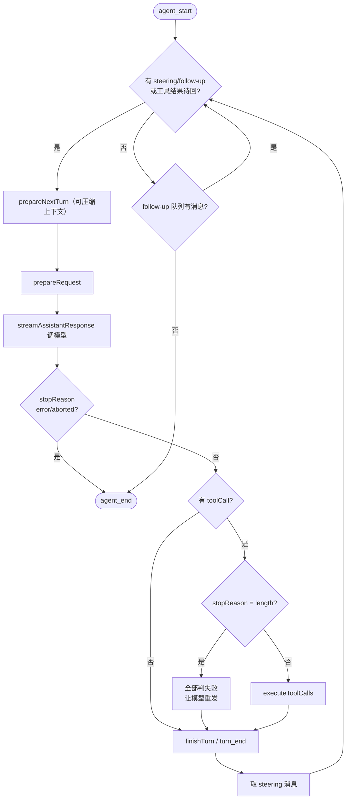

> 基于 [earendil-works/pi](https://github.com/earendil-works/pi) **commit `a758f3a`（2026-11-03 读取）**，代码摘录按 MIT 许可引用，有删减。

**本篇重点**：这是整个系列最核心的一篇。我们逐段读 [`packages/agent/src/agent-loop.ts`](https://github.com/earendil-works/pi/blob/a758f3ae4cdb193a6949c81318fe1b3caa4814a1/packages/agent/src/agent-loop.ts)（959 行）和 [`agent.ts`](https://github.com/earendil-works/pi/blob/a758f3ae4cdb193a6949c81318fe1b3caa4814a1/packages/agent/src/agent.ts)，弄懂：Agent 循环怎么转、什么时候停、工具怎么并行执行、钩子插在哪、事件怎么发、状态存在哪。

<!-- more -->

## 人话直觉

Agent 循环就是下面这段伪代码：

```text
把用户消息加入上下文
循环:
    调模型，拿到回复（可能含工具调用）
    如果没有工具调用 → 结束
    执行所有工具调用，把结果加入上下文
```

Pi 在这个骨架上加了几样「工业级」的东西：
1. **两层循环**：内层处理工具调用和「插话」（steering），外层处理「排队的后续消息」（follow-up）。
2. **钩子**：工具执行前后、每轮请求前、每轮结束时，都留了可插入的函数。
3. **事件**：每一步都发事件，UI、会话存储都靠订阅事件工作。
4. **容错**：找不到工具、参数校验失败、工具抛错、输出被截断……全部变成「错误工具结果」交还给模型，而不是让程序崩溃。

## 源码走读 1：类型——AgentMessage、AgentTool、AgentEvent

文件 [`agent/src/types.ts`](https://github.com/earendil-works/pi/blob/a758f3ae4cdb193a6949c81318fe1b3caa4814a1/packages/agent/src/types.ts)。

### 可扩展的消息类型（L365-L374）

```ts
export interface CustomAgentMessages {
	// Empty by default - apps extend via declaration merging
}

export type AgentMessage = Message | CustomAgentMessages[keyof CustomAgentMessages];
```

- `AgentMessage` = pi-ai 的 4 种 `Message` + 应用自定义的消息。
- 应用通过 TypeScript 的**声明合并**往 `CustomAgentMessages` 里加类型（比如 coding-agent 加了 `bashExecution`、`compactionSummary` 等角色）。
- 文件头注释点出关键：循环里全程用 `AgentMessage`，**只在调用 LLM 的边界才转换成 `Message[]`**。

### 工具接口（L478 起）

```ts
export interface AgentTool<TParameters extends object = object, TDetails = any> extends Tool<TParameters> {
	label: string;
	prepareArguments?: (args: unknown) => AgentToolParams<TParameters>;
	execute: (
		toolCallId: string,
		params: AgentToolParams<TParameters>,
		signal?: AbortSignal,
		onUpdate?: AgentToolUpdateCallback<TDetails>,
	) => Promise<AgentToolResult<TDetails>>;
	executionMode?: ToolExecutionMode;
	// ...
}
```

- 继承 pi-ai 的 `Tool`（`name`、`description`、`parameters` JSON Schema）。
- `prepareArguments`：校验前的「兼容垫片」，用来修正模型发来的不规范参数（第 4 篇的 edit 工具就用了）。
- `execute` 拿到**已校验**的参数、取消信号 `signal`、以及 `onUpdate` 回调（长任务可以流式汇报进度，比如 bash 输出）。
- `executionMode`：这个工具能否与别的工具并行。

### 工具结果（L424 起）

```ts
export interface AgentToolResult<T = JsonValue | undefined> {
	content: (TextContent | ImageContent)[];   // 给模型看的
	details: T;                                 // 给 UI/日志看的
	structuredContent?: JsonValue;
	usage?: Usage;
	isError?: boolean;
	terminate?: boolean;
}
```

**`content` 与 `details` 分离**是个好设计：比如 edit 工具给模型的 `content` 只是 "Successfully replaced 1 block(s)"，而 `details` 里有完整 diff 给界面渲染——省 token。`terminate`：注释说只有**本批所有工具结果都设了 `terminate: true`** 才提前停止。

### 事件（L528 起）

```ts
export type AgentEvent =
	| { type: "agent_start" }
	| { type: "agent_end"; messages: AgentMessage[] }
	| { type: "turn_start" }
	| { type: "turn_end"; message: AgentMessage; toolResults: ToolResultMessage[] }
	| { type: "message_start"; message: AgentMessage }
	| { type: "message_update"; message: AgentMessage; assistantMessageEvent: AssistantMessageEvent }
	| { type: "message_end"; message: AgentMessage }
	| { type: "tool_execution_start"; toolCallId: string; toolName: string; args: any }
	| { type: "tool_execution_update"; /* ... */ partialResult: any }
	| { type: "tool_execution_end"; /* ... */ };
```

三个层级：**agent（一次运行）⊃ turn（一轮：一次模型回复 + 它的工具调用）⊃ message / tool_execution**。

## 源码走读 2：入口 runAgentLoop（L111-L135）

```ts
export async function runAgentLoop(prompts, context, config, emit, signal, streamFn) {
	const initialMessages = declareToolChanges(context, prompts);
	const newMessages: AgentMessage[] = [...initialMessages];
	const currentContext: AgentContext = {
		...context,
		messages: [...context.messages, ...initialMessages],
	};

	await emit({ type: "agent_start" });
	await emit({ type: "turn_start" });
	for (const message of initialMessages) {
		await emit({ type: "message_start", message });
		await emit({ type: "message_end", message });
	}

	await runLoop(currentContext, newMessages, config, signal, emit, streamFn ?? getDefaultStreamFn());
	return newMessages;
}
```

- `declareToolChanges`（L342）：比较「对话记录里已声明的工具」和 `context.tools`（实际可执行的工具），有差异就插一条带 `toolsAdded/toolsRemoved` 的 system 消息（呼应第 2 篇）。
- 复制一份上下文 `currentContext`，**不直接改调用方传进来的数组**。
- `newMessages` 收集本次运行产生的所有新消息，最后返回。
- 用户消息也会发 `message_start/message_end`，这样订阅者（比如会话存储）对所有消息一视同仁。

`agentLoop()`（L47）是它的「流式外壳」：内部调 `runAgentLoop`，把 `emit` 接到一个 `EventStream`，让调用方可以 `for await` 消费事件。

## 源码走读 3：主循环 runLoop（L172-L330）

我把核心骨架摘出来（删了模型/思考级别更新的细节）：

```ts
let pendingMessages: AgentMessage[] = (await config.getSteeringMessages?.()) || [];

while (true) {                                            // 外层：follow-up
	let hasMoreToolCalls = true;
	while (hasMoreToolCalls || pendingMessages.length > 0) { // 内层：工具 + steering
		if (lastCompletedTurn) {
			const nextTurnSnapshot = await config.prepareNextTurn?.(lastCompletedTurn);
			// ... 用快照替换 context / model / thinkingLevel
			await emit({ type: "turn_start" });
		}
		for (const message of declareToolChanges(currentContext, [...preparedMessages, ...pendingMessages])) {
			// emit message_start/end，加入 currentContext.messages 和 newMessages
		}
		pendingMessages = [];

		const requestUpdate = await config.prepareRequest?.({ /* ... */ }, signal);
		// ...
		const message = await streamAssistantResponse(currentContext, config, signal, emit, streamFunction);
		newMessages.push(message);

		if (message.stopReason === "error" || message.stopReason === "aborted") {
			// finishTurn、turn_end、agent_end，然后 return
		}

		const toolCalls = message.content.filter((c) => c.type === "toolCall");
		hasMoreToolCalls = false;
		if (toolCalls.length > 0) {
			const executedToolBatch =
				message.stopReason === "length"
					? await failToolCallsFromTruncatedMessage(toolCalls, emit)
					: await executeToolCalls(currentContext, message, config, signal, emit);
			toolResults.push(...executedToolBatch.messages);
			hasMoreToolCalls = !executedToolBatch.terminate;
			// 工具结果加入上下文
		}

		const decision = await config.finishTurn?.(lastCompletedTurn, signal);
		await emit({ type: "turn_end", message, toolResults });
		if (decision?.action === "end") { /* agent_end; return */ }

		pendingMessages = (await config.getSteeringMessages?.()) || [];
	}

	const followUpMessages = (await config.getFollowUpMessages?.()) || [];
	if (followUpMessages.length > 0) {
		pendingMessages = followUpMessages;
		continue;
	}
	// ...（explicitContinuation 分支略）
	break;
}
await emit({ type: "agent_end", messages: newMessages });
```

逐段讲：

1. **一开始就取一次 steering 消息**：源码注释 "user may have typed while waiting"——用户可能在等待时已经打了字。
2. **内层循环条件** `hasMoreToolCalls || pendingMessages.length > 0`：只要还有工具结果要回给模型，或者用户插了话，就继续下一轮。
3. **`prepareNextTurn`**：每轮（第一轮除外）开始前的钩子，可以替换上下文、模型、思考级别。coding-agent 正是在这里做**上下文压缩**和刷新系统提示词（第 4 篇）。注释还提醒：准备工作可能很耗时（如压缩），所以完成后会再取一次 steering 消息。
4. **`prepareRequest`**：每次请求模型前最后一个钩子。
5. **出错/中止就整体结束**，不再尝试工具。
6. **`stopReason === "length"` 时不执行任何工具**——见下文。
7. **`terminate`**：工具全部要求终止时，`hasMoreToolCalls` 为 false，不再回调模型。
8. **`finishTurn`** 可返回 `{ action: "end" }` 强制结束，或 `"continue"` 要求再来一轮。
9. 内层退出后（模型不再调工具），检查 **follow-up 队列**；有就继续外层循环，没有才真正 `break`。



### steering 和 follow-up 的区别

文档 `how-pi-works.md` 原话："Steering messages enter after the current assistant turn. Follow-up messages enter after the agent has finished its pending work."
- **steering（插话）**：当前这一轮结束后立刻插入，影响下一轮——比如你看到 Agent 走偏了，马上纠正。
- **follow-up（追加）**：等 Agent 把手头工作（包括所有工具调用）做完才处理。

对应 `Agent` 类的 `steer()` 和 `followUp()` 方法，两个队列默认模式都是 `"one-at-a-time"`（agent.ts 构造函数）。

## 源码走读 4：调模型 streamAssistantResponse（L390-L479）

```ts
let messages = context.messages;
if (config.transformContext) {
	messages = await config.transformContext(messages, signal);
}
const llmMessages = await config.convertToLlm(messages);
const llmContext = normalizeContext({ messages: llmMessages });

const resolvedApiKey =
	(config.getApiKey ? await config.getApiKey(config.model.provider) : undefined) || config.apiKey;

const response = await streamFunction(config.model, llmContext, { ...config, apiKey: resolvedApiKey, /* ... */ signal });
```

- **两步转换**：`transformContext`（AgentMessage[] → AgentMessage[]，比如裁剪、注入）→ `convertToLlm`（AgentMessage[] → Message[]，去掉模型不认识的自定义消息）。默认的 `defaultConvertToLlm`（agent.ts L39）就是只保留 4 种标准角色。
- **每次请求都重新取 API Key**：注释写 "important for expiring tokens"——OAuth token 可能会过期。

然后消费事件流：

```ts
for await (const event of response) {
	switch (event.type) {
		case "start":
			partialMessage = event.partial;
			context.messages.push(partialMessage);
			addedPartial = true;
			await emit({ type: "message_start", message: { ...partialMessage } });
			break;
		case "text_delta": /* 以及其它 *_start/_delta/_end */
			if (partialMessage) {
				partialMessage = event.partial;
				context.messages[context.messages.length - 1] = partialMessage;
				await emit({ type: "message_update", assistantMessageEvent: event, message: { ...partialMessage } });
			}
			break;
		case "done":
		case "error": {
			const finalMessage = await result();
			// 用最终消息替换上下文末尾的部分消息
			await emit({ type: "message_end", message: finalMessage });
			return finalMessage;
		}
	}
}
```

- `start` 时就把「半成品」消息放进上下文末尾，后续每个增量**原地替换**它。
- 发给订阅者时用 `{ ...partialMessage }` 浅拷贝，避免订阅者拿到的引用被后续修改（第 2 篇说过 `partial` 是共享对象）。
- 结束时用 `result()` 的最终消息替换。

## 源码走读 5：工具执行

### 串行还是并行？（L518-L533）

```ts
const hasSequentialToolCall = toolCalls.some(
	(tc) => currentContext.tools?.find((t) => t.name === tc.name)?.executionMode === "sequential",
);
if (config.toolExecution === "sequential" || hasSequentialToolCall) {
	return executeToolCallsSequential(/* ... */);
}
return executeToolCallsParallel(/* ... */);
```

全局默认是 `"parallel"`（agent.ts L261：`this.toolExecution = runtimeOptions.toolExecution ?? "parallel"`）。只要这一批里**有任何一个**工具声明必须串行，整批就串行。

### 并行的细节（L596-L670）

类型注释（types.ts L43）写明："tool calls are prepared sequentially, then allowed tools execute concurrently"。代码：

```ts
for (const toolCall of toolCalls) {
	await emit({ type: "tool_execution_start", /* ... */ });
	const preparation = await prepareToolCall(currentContext, assistantMessage, toolCall, config, signal);
	if (preparation.kind === "immediate") {
		// 找不到工具 / 校验失败 / 被拦截：直接得到结果
		finalizedCalls.push(finalized);
		continue;
	}
	finalizedCalls.push(async () => { /* 真正执行 + afterToolCall */ });
}

const orderedFinalizedCalls = await Promise.all(
	finalizedCalls.map((entry) => (typeof entry === "function" ? entry() : Promise.resolve(entry))),
);
```

- **准备阶段串行**：参数校验和 `beforeToolCall`（可能弹窗问用户是否允许）一个一个来——不然你会同时收到好几个确认框。
- **执行阶段并发**：把执行包成函数，最后 `Promise.all` 一起跑。
- **结果按原顺序**：`Promise.all` 保持数组顺序，所以 `toolResult` 消息的顺序与模型发出的调用顺序一致，与谁先跑完无关。

### 准备一次调用 prepareToolCall（L718-L787）

```ts
const tool = tools.find((t) => t.name === toolCall.name);
if (!tool) {
	return { kind: "immediate", result: createErrorToolResult(`Tool ${toolCall.name} not found`), isError: true };
}
try {
	const preparedToolCall = prepareToolCallArguments(tool, toolCall);
	const validatedArgs = validateToolArguments(tool, preparedToolCall);
	if (config.beforeToolCall) {
		const beforeResult = await config.beforeToolCall({ assistantMessage, toolCall, args: validatedArgs, context: currentContext }, signal);
		// ...
		if (beforeResult?.block) {
			const result = createErrorToolResult(beforeResult.reason || "Tool execution was blocked");
			// ...
			return { kind: "immediate", result, isError: true };
		}
	}
	// ...
	return { kind: "prepared", toolCall, tool, args: validatedArgs };
} catch (error) {
	return { kind: "immediate", result: createErrorToolResult(error instanceof Error ? error.message : String(error)), isError: true };
}
```

四道关：**找工具 → 兼容垫片 → Schema 校验 → beforeToolCall 拦截**。任何一关失败都变成一条错误结果（`isError: true`）发回给模型——模型看到 "Tool xxx not found" 或校验报错，下一轮通常会自己改正。这就是 Agent 的**自我纠错**机制。

`validateToolArguments`（pi-ai `utils/validation.ts` L54）的错误信息包含每个字段的错误路径以及收到的原始参数，方便模型修正；并且它校验的是 `structuredClone` 出来的副本，注释说这样工具修改参数时不会改到对话记录里的工具调用。

### 执行与收尾（L831-L920）

`executePreparedToolCall`：调用 `tool.execute(...)`，用 `performance.now()` 计时得到 `durationMs`；`execute` 抛出的异常被 catch 成错误结果；工具结束后不再接受 `onUpdate`（`acceptingUpdates = false`）。

`finalizeExecutedToolCall`：如果有 `afterToolCall`，它可以覆盖 `content`、`details`、`isError`、`terminate` 等字段；钩子自己抛错也会变成错误结果。

### 输出被截断时（L488-L513）

```ts
result: createErrorToolResult(
	`Tool call "${toolCall.name}" was not executed: the response hit the output token limit, so its arguments may be truncated. Re-issue the tool call with complete arguments.`,
),
```

注释解释得很到位：流式参数用「尽力修复」的 JSON 解析器收尾，截断的消息可能产生**能通过校验但内容不完整**的参数——比如 `write` 只写了半个文件。所以干脆全部不执行，让模型重发。这是面试里很好的「工程细节」素材。

## 源码走读 6：Agent 类——状态与生命周期

[`agent.ts`](https://github.com/earendil-works/pi/blob/a758f3ae4cdb193a6949c81318fe1b3caa4814a1/packages/agent/src/agent.ts) 的 `Agent` 类（L194 起）是对循环的有状态封装：

- `prompt()`（L382）：如果已经在运行就抛错 "Agent is already processing a prompt. Use steer() or followUp() to queue messages, or wait for completion."；否则把字符串包装成 `user` 消息，调 `runAgentLoop`。
- `runWithLifecycle`（L517）：创建 `AbortController`，标记 `isStreaming`；运行中抛出的异常交给 `handleRunFailure`（L542），它**伪造一条 `stopReason` 为 `error` 或 `aborted` 的助手消息**并补发 `message_end / turn_end / agent_end`——保证订阅者总能看到完整的事件序列。
- `processEvents`（L575）：先根据事件更新内部状态，再**按订阅顺序逐个 await 监听器**：

```ts
case "message_end":
	this._state.streamingMessage = undefined;
	this._state.messages.push(event.message);
	break;
case "tool_execution_start": {
	const pendingToolCalls = new Set(this._state.pendingToolCalls);
	pendingToolCalls.add(event.toolCallId);
	this._state.pendingToolCalls = pendingToolCalls;
	break;
}
```

  注意 `pendingToolCalls` 每次都**新建一个 Set** 再赋值，而不是原地修改——**推断**：这样便于 UI 用引用比较发现变化。
- 状态 `messages` 只在 `message_end` 时追加，所以 `agent.state.messages` 里只有**完整消息**；流式中的半成品在 `streamingMessage` 里。
- `abort()` 触发 `AbortController`，信号一路传到模型请求和每个工具的 `execute`。

## 设计取舍

- **错误即消息**：鲁棒、模型可自愈；代价是坏工具可能让模型反复重试浪费 token（需要上层限制）。
- **准备串行、执行并行**：兼顾权限确认的交互体验与执行速度；代价是写文件类工具需要自己处理同文件并发（coding-agent 用 `withFileMutationQueue`，见第 4 篇）。
- **钩子而非继承**：`beforeToolCall / afterToolCall / prepareNextTurn / prepareRequest / finishTurn / transformContext / convertToLlm` 都是可选函数，组合灵活；代价是执行顺序需要读源码才能完全理解。
- **监听器被 await**：保证事件按顺序处理（比如先写盘再继续），代价是慢监听器会拖慢 Agent。

## 常见误区

- ❌「并行执行时结果顺序不确定」——结果消息按调用顺序生成。
- ❌「工具抛异常会让 Agent 崩溃」——被捕获为 `isError: true` 的工具结果。
- ❌「设置了 terminate 的工具一定会停止 Agent」——要本批所有结果都 `terminate: true`。
- ❌「steering 和 follow-up 一样」——前者在当前轮后插入，后者等全部工作结束。

## 面试问答

1. **问：讲讲 Agent 循环的终止条件。**
   答：模型回复没有工具调用且没有 steering/follow-up 消息；或模型出错/被中止；或 `finishTurn` 返回 end；或本批工具全部要求 terminate。
2. **问：多个工具调用如何并行？有什么坑？**
   答：Pi 先串行做查找、校验、权限钩子，再并发执行，结果按原顺序回填；坑是共享资源竞争（如同一文件），以及有副作用的工具要能声明 sequential。
3. **问：模型调用了不存在的工具/参数错误怎么办？**
   答：返回错误工具结果（含校验详情），让模型下一轮自我修正，而不是抛出。
4. **问：输出被 max tokens 截断，但有工具调用，怎么处理？**
   答：Pi 不执行任何工具，返回错误提示要求重发，因为参数可能被「修复」成合法但不完整的 JSON。
5. **问：如何实现人类在环（human-in-the-loop）的权限确认？**
   答：在 `beforeToolCall` 钩子里询问用户，返回 `{ block: true, reason }` 拒绝。
6. **问：为什么要区分 AgentMessage 和 LLM Message？**
   答：应用需要存 UI 通知、压缩摘要等自定义消息，但模型只认标准角色；在调用边界用 `convertToLlm` 转换。
7. **问：如何在 Agent 运行中途让用户插话？**
   答：steering 队列，每轮结束时轮询并注入下一轮。
8. **问：工具结果为什么分 content 和 details？**
   答：content 给模型（越精简越省 token），details 给 UI/日志（完整 diff 等）。

## 自测题

1. 一批 3 个工具调用，其中一个声明 `executionMode: "sequential"`，会怎么执行？
2. `agent.state.messages` 在模型流式输出期间包含半成品消息吗？
3. `beforeToolCall` 返回 `{ block: true }` 后，模型会看到什么？

<details><summary>答案</summary>

1. 整批串行（`hasSequentialToolCall` 为真）。
2. 不包含；`messages` 只在 `message_end` 追加，半成品在 `streamingMessage`。（注意：循环内部的 `context.messages` 会放半成品，那是循环自己的上下文副本。）
3. 一条 `isError: true` 的 toolResult，内容是 `reason` 或默认的 "Tool execution was blocked"。第 6 篇有真实运行输出。
</details>

## 参考资料

- `packages/agent/src/agent-loop.ts`、`agent.ts`、`types.ts`、`stream-fn.ts`（commit a758f3a，链接见文中）
- `packages/ai/src/utils/validation.ts`
- pi-agent-core README：https://github.com/earendil-works/pi/blob/a758f3ae4cdb193a6949c81318fe1b3caa4814a1/packages/agent/README.md
- How Pi Works：https://github.com/earendil-works/pi/blob/a758f3ae4cdb193a6949c81318fe1b3caa4814a1/packages/coding-agent/docs/how-pi-works.md

**系列目录**：[（一）总览](/2026/11/03/pi-source-01-overview/) · [（二）pi-ai](/2026/11/03/pi-source-02-pi-ai/) · [（三）Agent 主循环](/2026/11/03/pi-source-03-agent-loop/) · [（四）编程助手工具与会话](/2026/11/03/pi-source-04-coding-agent/) · [（五）扩展与运行模式](/2026/11/03/pi-source-05-extensions-modes/) · [（六）动手写最小 Agent](/2026/11/03/pi-source-06-hands-on/)
