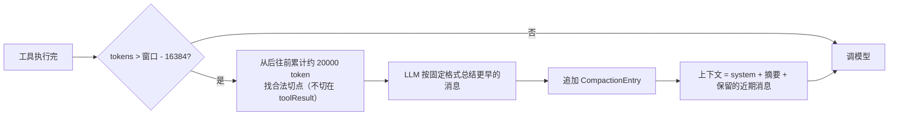

> 基于 [earendil-works/pi](https://github.com/earendil-works/pi) **commit `a758f3a`（2026-11-03 读取）**，代码摘录按 MIT 许可引用，有删减。

**本篇重点**：一个「编程助手」在通用 Agent 之上到底多做了什么？我们读四块：**read/write/edit/bash 工具**、**系统提示词是怎么拼出来的**、**会话如何存成 JSONL 树**、**上下文快满时怎么压缩**。

<!-- more -->

## 人话直觉

通用 Agent 只是「发动机」。编程助手要能真正改代码，还需要：
- **手**：读文件、写文件、精确修改、跑命令；
- **说明书**：系统提示词告诉模型有哪些工具、守哪些规矩、项目有什么约定（AGENTS.md）；
- **记忆**：对话存盘，下次能接着聊、能回到某一步分叉；
- **瘦身**：对话太长塞不进模型的上下文窗口时，把旧内容总结成摘要。

## 源码走读 1：内置工具

目录 [`packages/coding-agent/src/core/tools/`](https://github.com/earendil-works/pi/tree/a758f3ae4cdb193a6949c81318fe1b3caa4814a1/packages/coding-agent/src/core/tools)。可用工具名（`index.ts`）：`read`、`bash`、`powershell`、`edit`、`write`、`grep`、`find`、`ls`。默认编程工具集只有四个（[`index.ts` L195](https://github.com/earendil-works/pi/blob/a758f3ae4cdb193a6949c81318fe1b3caa4814a1/packages/coding-agent/src/core/tools/index.ts#L195)）：

```ts
export function createCodingTools(cwd: string, options?: ToolsOptions): Tool[] {
	return [
		createReadTool(cwd, options?.read),
		createBashTool(cwd, options?.bash),
		createEditTool(cwd, options?.edit),
		createWriteTool(cwd, options?.write),
	];
}
```

另有 `createReadOnlyTools`：`read / grep / find / ls`——只读模式。系统提示词的默认工具也是 `["read", "bash", "edit", "write"]`（`system-prompt.ts` 的 `normalizeBuildSystemPromptOptions`）。

每个工具都有两种形态：`createXxxToolDefinition`（带 UI 渲染器等的完整定义）和 `createXxxTool`（用 `wrapToolDefinition` 包成第 3 篇讲的 `AgentTool`）。

### write：最简单的那个

[`tools/write.ts`](https://github.com/earendil-works/pi/blob/a758f3ae4cdb193a6949c81318fe1b3caa4814a1/packages/coding-agent/src/core/tools/write.ts)：

```ts
const writeSchema = Type.Object({
	path: Type.String({ description: "Path to the file to write (relative or absolute)" }),
	content: Type.String({ description: "Content to write to the file" }),
});
// ...
async execute(_toolCallId, { path, content }, signal?, _onUpdate?, ctx?) {
	const absolutePath = resolveToCwd(path, ctx?.cwd || cwd);
	const dir = dirname(absolutePath);
	return withFileMutationQueue(absolutePath, async () => {
		const throwIfAborted = (): void => {
			if (signal?.aborted) throw new Error("Operation aborted");
		};
		throwIfAborted();
		await ops.mkdir(dir);
		throwIfAborted();
		await ops.writeFile(absolutePath, content);
		throwIfAborted();
		return { content: [{ type: "text", text: `Successfully wrote to ${path}` }], details: undefined };
	});
},
```

- 参数用 TypeBox 定义成 JSON Schema，`description` 会被发给模型。
- 相对路径按工作目录解析；自动创建父目录。
- 每个 await 之后检查是否被取消。源码注释解释了为什么**不在 abort 事件监听里直接 reject**：那会在文件系统操作还没完成时就释放队列锁。
- `ops` 是可替换的「操作接口」（`WriteOperations`），注释说可以换成远程实现（例如 SSH）——工具逻辑和 I/O 解耦。

### withFileMutationQueue：同一文件串行，不同文件并行

第 3 篇说过工具默认**并行**执行。如果模型一次发两个 edit 改同一个文件就会冲突。[`tools/file-mutation-queue.ts` L32](https://github.com/earendil-works/pi/blob/a758f3ae4cdb193a6949c81318fe1b3caa4814a1/packages/coding-agent/src/core/tools/file-mutation-queue.ts#L32) 的注释："Serialize file mutation operations targeting the same file. Operations for different files still run in parallel."

```ts
const key = await getMutationQueueKey(filePath);         // realpath，符号链接也算同一文件
const currentQueue = fileMutationQueues.get(key) ?? Promise.resolve();
let releaseNext!: () => void;
const nextQueue = new Promise<void>((resolveQueue) => { releaseNext = resolveQueue; });
const chainedQueue = currentQueue.then(() => nextQueue);
fileMutationQueues.set(key, chainedQueue);
// ...
await currentQueue;          // 等前一个操作完成
try {
	return await fn();
} finally {
	releaseNext();           // 放行下一个
}
```

这是一个**按文件路径的 Promise 链锁**：每个操作排在同路径上一个操作的后面。用 `realpath` 作为键，所以两个不同路径指向同一个文件也会排队。

### edit：精确文本替换

[`tools/edit.ts`](https://github.com/earendil-works/pi/blob/a758f3ae4cdb193a6949c81318fe1b3caa4814a1/packages/coding-agent/src/core/tools/edit.ts) 的参数是 `path` + `edits[]`，每个 edit 是 `{ oldText, newText }`。工具描述要求：每个 `oldText` 必须在**原文件中唯一**、且彼此不重叠。

`prepareArguments`（第 3 篇讲的兼容垫片）在这里派上用场：

```ts
// Some models (Opus 4.6, GLM-5.1) send edits as a JSON string instead of an array.
// Others send a single edit object instead of a one-element edits array.
if (typeof args.edits === "string") {
	try {
		const parsed = JSON.parse(args.edits);
		// ... 数组就用，单个对象就包成数组
	} catch {}
} else if (isSingleEditInput(args.edits)) {
	args.edits = [args.edits];
}
```

注释直接点名了会犯这些格式错误的模型——这就是真实工程里「模型不完全听话」的应对。它还兼容老格式：顶层直接给 `oldText/newText`。

核心逻辑在 [`edit-diff.ts` 的 `applyEditsToNormalizedContent`（L300 起）](https://github.com/earendil-works/pi/blob/a758f3ae4cdb193a6949c81318fe1b3caa4814a1/packages/coding-agent/src/core/tools/edit-diff.ts#L300)：

1. 统一换行为 `\n`（执行前 `edit.ts` 还会去掉 BOM、记录原换行风格，写回时恢复）；
2. 每个 `oldText` 不能为空；
3. 用 `fuzzyFindText` 查找：**先精确匹配，找不到再模糊匹配**；
4. 出现多次 → 报错（要求更长、唯一的片段）；
5. 按位置排序，检查有没有重叠 → 报错 "overlap … Merge them into one edit"；
6. 替换后内容与原来相同 → 报「没有变化」错误。

模糊匹配做了哪些归一化？`normalizeForFuzzyMatch`（L34）的注释列得很清楚：去掉每行行尾空白、智能引号转 ASCII 引号、各种 Unicode 破折号转 `-`、特殊 Unicode 空格转普通空格（还先做了 NFKC 规范化）。**推断**：这是因为模型复述代码时常常把引号、空白"抄错"，模糊匹配提高了 edit 成功率。

返回给模型的 `content` 只有一句 "Successfully replaced N block(s) in path."，完整 diff 放在 `details` 给界面——呼应第 3 篇的 content/details 分离。

### bash 与 read：输出截断

[`tools/truncate.ts`](https://github.com/earendil-works/pi/blob/a758f3ae4cdb193a6949c81318fe1b3caa4814a1/packages/coding-agent/src/core/tools/truncate.ts) L11-L12：

```ts
export const DEFAULT_MAX_LINES = 2000;
export const DEFAULT_MAX_BYTES = 50 * 1024; // 50KB
```

bash 工具的描述（`bash.ts` L254）把这条规则直接写给模型看："Output is truncated to last 2000 lines or 50KB (whichever is hit first). If truncated, full output is saved to a temp file."（源码里用模板字符串插入这两个常量。）
- bash 保留**最后**的输出（报错一般在最后），截断时完整输出存到临时文件；
- `timeout` 参数单位是秒，描述写明"no default timeout"（默认不超时）；超时会 `killProcessTree` 杀掉整个进程树（非 Windows 下用 `detached` 启动子进程）。
- read 工具则用 `truncateHead` 保留**开头**；参数为 `path`、`offset`（从第几行开始，1 起）、`limit`（最多读几行），配合截断就能分页读大文件。

## 源码走读 2：系统提示词怎么拼

[`core/system-prompt.ts`](https://github.com/earendil-works/pi/blob/a758f3ae4cdb193a6949c81318fe1b3caa4814a1/packages/coding-agent/src/core/system-prompt.ts) 的 `buildSystemPromptSections`（L128 起）。没有自定义提示词时，按顺序生成这些分段：

| 分段名 | 内容（来自源码） |
|---|---|
| `preamble` | "You are a coding assistant running inside pi, a coding agent harness. Help users inspect files, run commands, and modify code." |
| `tools` | 每个可见工具一行：`- 名字: 一句话简介`（来自各工具的 `promptSnippet`），末尾 "Additional tools may be available." |
| `rules` | `buildRules()` 汇总：各工具的 `promptGuidelines` + 自定义规则 + 固定两条 "Be concise in your responses"、"Show file paths clearly when working with files" |
| `docs` | Pi 自己文档的路径（只在用户问 Pi 本身时才读） |
| `addendum` | 用户配置追加的提示词 |
| `project_context` | 项目上下文文件（见下） |
| `skills` | 技能清单（第 5 篇） |
| `cwd` | 当前工作目录 |

除 `preamble` 外，每段都被包成 `<名字>…</名字>` 标签。注释说这样「模型可以把后续更新与原分段对应起来」——呼应第 2 篇 `SystemMessage.sections` 可按名替换。

`buildRules` 里有个细节：如果有 bash 但没有 grep/find/ls 工具，就加一条 "Use bash for file operations like ls, rg, find"。**提示词随工具集动态变化**。

### 项目上下文：AGENTS.md

[`core/resource-loader.ts` L212 起](https://github.com/earendil-works/pi/blob/a758f3ae4cdb193a6949c81318fe1b3caa4814a1/packages/coding-agent/src/core/resource-loader.ts#L212)：

```ts
const candidates = ["AGENTS.override.md", "AGENTS.md", "AGENTS.MD", "CLAUDE.md", "CLAUDE.MD"];
```

每个目录按这个优先级取**第一个**存在的文件。`loadProjectContextFiles`（L260 起）先读全局目录（agentDir）里的，再从当前目录**一路往上走到根目录**，祖先目录的文件排在前面（`unshift`）。渲染时每个文件包成 `<project_instructions path="...">`。

## 源码走读 3：会话持久化——JSONL 树

仓库文档 `docs/session-format.md`：会话文件是 JSONL（一行一个 JSON），默认位置 `~/.pi/agent/sessions/--<path>--/<timestamp>_<session-id>.jsonl`。第一行是头部：

```json
{"type":"session","version":3,"id":"uuid","timestamp":"...","cwd":"/path/to/project"}
```

之后每行是一个条目，都有 `id` 和 `parentId`——**条目组成一棵树**，不是线性列表。`session-manager.ts` 定义的条目类型有：`message`、`thinking_level_change`、`model_change`、`usage`、`compaction`、`branch_summary`、`custom`、`label`、`session_info`、`custom_message`、`context_edit`。

为什么是树？`how-pi-works.md` 解释：从某个较早的条目继续，就在同一个文件里长出一个新分支；当前条目（叶子）决定「活动分支」，下一次请求的历史就是从根走到叶子的路径。这让你可以「回到第 5 步换个思路」而不丢失原来的尝试。

## 源码走读 4：上下文压缩（compaction）

### 何时触发

[`compaction/compaction.ts` L267](https://github.com/earendil-works/pi/blob/a758f3ae4cdb193a6949c81318fe1b3caa4814a1/packages/coding-agent/src/core/compaction/compaction.ts#L267)：

```ts
export function shouldCompact(contextTokens: number, contextWindow: number, settings: CompactionSettings): boolean {
	if (!settings.enabled) return false;
	return contextTokens > contextWindow - settings.reserveTokens;
}
```

默认值（L128-L129，`settings-defaults.ts` 同）：`reserveTokens: 16384`、`keepRecentTokens: 20000`。即：上下文 token 数超过「窗口大小 − 16384」就压缩，压缩时保留最近约 2 万 token 的原文。

**在哪里调用**：coding-agent 的 `AgentSession._installAgentNextTurnRefresh`（[`agent-session.ts` L914 起](https://github.com/earendil-works/pi/blob/a758f3ae4cdb193a6949c81318fe1b3caa4814a1/packages/coding-agent/src/core/agent-session.ts#L914)）把第 3 篇的 `prepareNextTurn` 钩子接上：

```ts
this.agent.prepareNextTurnWithContext = async (turn, signal) => {
	const context = await this._compactBeforeNextAssistantResponse(turn.context);
	// ... 然后按当前工具集重建系统提示词，必要时生成一条更新用的 system 消息
};
```

也就是：**工具执行完、下一次调模型前**检查并压缩。`docs/compaction.md` 还提到：新用户消息之前也会检查；遇到厂商的上下文溢出错误时会做一次「压缩后重试」。

### token 怎么估算

`estimateTokens`（L298 起）：按字符数除以 4 向上取整（`Math.ceil(chars / 4)`）。这是粗略估计，不是真实分词。

### 在哪里切

```ts
function isCutPointMessage(message: AgentMessage): boolean {
	switch (message.role) {
		case "user": case "assistant": case "bashExecution": case "custom":
		case "branchSummary": case "compactionSummary":
			return true;
		case "toolResult":
			return false;
	}
	return false;
}
```

注释："Never cut at tool results (they must follow their tool call)"——**不能从工具结果处切**，否则会留下没有对应调用的孤立结果，很多厂商 API 会直接报错。

### 摘要格式

`SUMMARIZATION_PROMPT`（L507 起）要求模型严格按格式输出：`## Goal`、`## Constraints & Preferences`、`## Progress`（Done / In Progress / Blocked）、`## Key Decisions`、`## Next Steps`、`## Critical Context`，并要求 "Preserve exact file paths, function names, and error messages."。已有旧摘要时改用 `UPDATE_SUMMARIZATION_PROMPT`，要求保留旧信息、把完成的项从 In Progress 移到 Done——**迭代式摘要**。

### 压缩后发给模型什么

压缩结果作为 `CompactionEntry` 追加到会话（字段 `summary`、`firstKeptEntryId`、`tokensBefore` 等，`session-manager.ts` L91）。`buildContextEntries`（L476 起）重建上下文时：

```ts
const contextEntries: SessionEntry[] = [compaction];
let foundFirstKept = false;
for (let i = 0; i < compactionIdx; i++) {
	const entry = path[i];
	if (entry.id === compaction.firstKeptEntryId) foundFirstKept = true;
	if (foundFirstKept && !(entry.type === "message" && entry.message.role === "system")) {
		contextEntries.push(entry);
	}
}
contextEntries.push(...path.slice(compactionIdx + 1));
```

即：**摘要 + 从 `firstKeptEntryId` 起的原始消息 + 压缩之后的新消息**。旧条目仍留在文件里（文档原话 "The original entries remain in the session tree"），只是不再发给模型。



## 设计取舍

- **精确替换 vs 整文件重写 vs diff 补丁**：精确替换省 token、改动可控，但要求 oldText 唯一；Pi 用模糊匹配和明确的报错信息降低失败率。
- **截断保留尾部**：适合看报错，但可能丢掉开头信息；用临时文件兜底。
- **树形会话**：支持分支和回退；代价是重建上下文需要沿路径遍历、处理压缩条目。
- **摘要压缩**：节省上下文，但有信息损失；Pi 用结构化模板 + 迭代更新 + 保留近期原文来缓解。

## 常见误区

- ❌「压缩会删除历史」——原始条目仍在 JSONL 文件里，只是不再发给模型。
- ❌「edit 工具按行号改」——是按文本精确（或模糊）匹配替换。
- ❌「token 数是精确计算的」——触发压缩用的是字符数 / 4 的估算。
- ❌「工具并行执行一定会写坏文件」——同一真实路径会被文件队列串行化。

## 面试问答

1. **问：编程 Agent 的编辑工具怎么设计？**
   答：常见是「旧文本→新文本」精确替换：要求唯一匹配、不重叠，失败时返回可操作的错误；可加模糊匹配（空白、引号归一化）。Pi 还支持一次多处编辑。
2. **问：工具输出太长怎么办？**
   答：截断（Pi：2000 行 / 50KB）+ 告知模型已截断 + 完整内容落盘供后续读取；读文件支持 offset/limit 分页。
3. **问：上下文窗口不够时有哪些策略？**
   答：滑动窗口、摘要压缩、检索式记忆等。Pi 采用阈值触发的结构化摘要 + 保留近期原文。
4. **问：压缩时切分点要注意什么？**
   答：不能把工具调用和工具结果拆开；Pi 禁止在 toolResult 处切。
5. **问：系统提示词如何适配不同工具集？**
   答：分段组装，工具简介和规则来自工具自身的 snippet/guidelines，工具变化时重建并以 system 消息增量更新。
6. **问：AGENTS.md 是怎么被加载的？**
   答：全局目录 + 从 cwd 向上逐级查找，每级取优先级最高的一个文件，按祖先在前的顺序拼进提示词。
7. **问：并发工具写同一文件如何避免冲突？**
   答：按真实路径加 Promise 链锁，同文件串行、不同文件并行。

## 自测题

1. 模型发来的 `edits` 是一个 JSON 字符串，Pi 会怎么处理？
2. 窗口 128000 token、默认设置下，估算上下文到多少会触发压缩？
3. 压缩后，被总结掉的消息还在会话文件里吗？

<details><summary>答案</summary>

1. `prepareEditArguments` 尝试 `JSON.parse`，是数组就用、是单个 edit 对象就包成数组。
2. 超过 128000 − 16384 = 111616（估算值）。
3. 在。只是重建上下文时用摘要代替。
</details>

## 参考资料

- `packages/coding-agent/src/core/tools/{index,write,edit,edit-diff,file-mutation-queue,truncate,bash,read}.ts`
- `packages/coding-agent/src/core/system-prompt.ts`、`resource-loader.ts`、`session-manager.ts`、`compaction/compaction.ts`、`agent-session.ts`
- 仓库文档：[session-format.md](https://github.com/earendil-works/pi/blob/a758f3ae4cdb193a6949c81318fe1b3caa4814a1/packages/coding-agent/docs/session-format.md)、[compaction.md](https://github.com/earendil-works/pi/blob/a758f3ae4cdb193a6949c81318fe1b3caa4814a1/packages/coding-agent/docs/compaction.md)、[how-pi-works.md](https://github.com/earendil-works/pi/blob/a758f3ae4cdb193a6949c81318fe1b3caa4814a1/packages/coding-agent/docs/how-pi-works.md)

**系列目录**：[（一）总览](/2026/11/03/pi-source-01-overview/) · [（二）pi-ai](/2026/11/03/pi-source-02-pi-ai/) · [（三）Agent 主循环](/2026/11/03/pi-source-03-agent-loop/) · [（四）编程助手工具与会话](/2026/11/03/pi-source-04-coding-agent/) · [（五）扩展与运行模式](/2026/11/03/pi-source-05-extensions-modes/) · [（六）动手写最小 Agent](/2026/11/03/pi-source-06-hands-on/)
