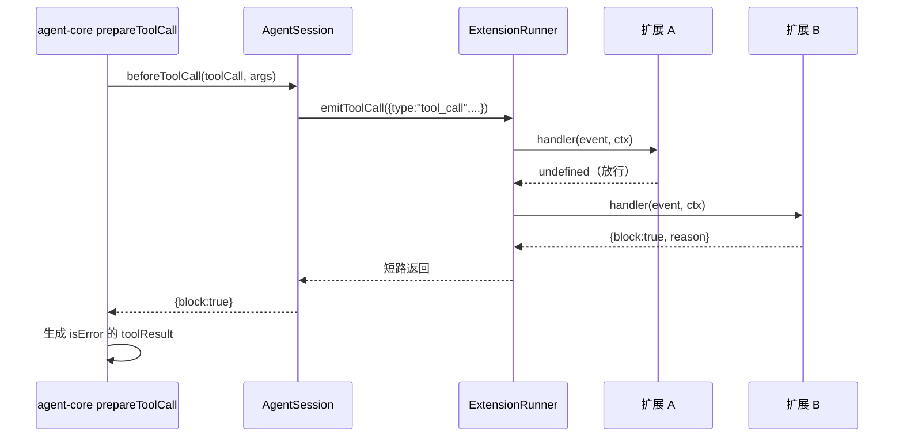
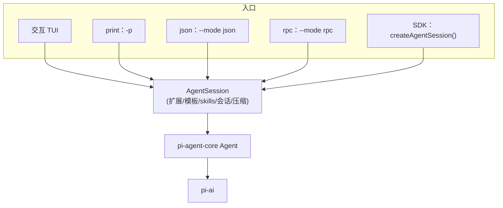

> 基于 [earendil-works/pi](https://github.com/earendil-works/pi) **commit `a758f3a`（2026-11-03 读取）**，代码摘录按 MIT 许可引用，有删减。

**本篇重点**：Pi 自称「极简、可扩展」，扩展能力从哪来？本篇读三种定制方式——**扩展（Extensions）**、**技能（Skills）**、**提示模板（Prompt Templates）**——以及同一个 Agent 如何以**交互 / print / JSON / RPC / SDK** 五种方式对外提供服务。

<!-- more -->

## 人话直觉

三种定制方式，能力从弱到强：

| 方式 | 本质 | 能不能执行代码 | 典型用途 |
|---|---|---|---|
| 提示模板 | 一个 Markdown 文件 → 一条 `/命令`，展开成文字 | 不能 | 常用提问，如 `/review` |
| Skill | 一个目录 + `SKILL.md`，按需加载的说明书 | 本身不能（可附带脚本让模型用 bash 跑） | 专项流程，如处理 PDF |
| 扩展 | 一个 TypeScript 模块，跑在 Pi 进程里 | 能，权限等同 Pi 进程 | 自定义工具、权限拦截、界面、模型厂商 |

## 源码走读 1：扩展（Extensions）

### 怎么写

仓库文档 `docs/extensions.md` 的 Quick Start（摘录）：

```ts
import { type ExtensionAPI, isToolCallEventType } from "@earendil-works/pi-coding-agent";
import { Type } from "typebox";

export default function (pi: ExtensionAPI) {
  pi.on("tool_call", async (event, ctx) => {
    if (isToolCallEventType("bash", event) && event.input.command.includes("rm -rf")) {
      const ok = await ctx.ui.confirm("Dangerous!", "Allow rm -rf?");
      if (!ok) return { block: true, reason: "Blocked by user" };
    }
  });

  pi.registerTool({
    name: "greet",
    label: "Greet",
    description: "Greet someone by name",
    parameters: Type.Object({ name: Type.String({ description: "Name to greet" }) }),
    async execute(toolCallId, params, signal, onUpdate, ctx) {
      return { content: [{ type: "text", text: `Hello, ${params.name}!` }], details: {} };
    },
  });
}
```

- 扩展就是一个**默认导出的工厂函数**，拿到 `pi: ExtensionAPI`。
- `pi.on(事件名, 处理函数)` 订阅事件；`pi.registerTool` 注册工具（形状和第 3 篇的 `AgentTool` 一致，多了一个 `ctx`）。
- 放在 `~/.pi/agent/extensions/`（全局）或 `.pi/extensions/`（项目）会被自动发现；`pi -e ./path.ts` 临时加载。
- 加载器 [`core/extensions/loader.ts`](https://github.com/earendil-works/pi/blob/a758f3ae4cdb193a6949c81318fe1b3caa4814a1/packages/coding-agent/src/core/extensions/loader.ts) 文件头注释："loads TypeScript extension modules using jiti"——**jiti** 能直接运行 `.ts` 文件，不用先编译。

`ExtensionAPI`（[`extensions/types.ts` L1616 起](https://github.com/earendil-works/pi/blob/a758f3ae4cdb193a6949c81318fe1b3caa4814a1/packages/coding-agent/src/core/extensions/types.ts#L1616)）在这个 commit 下的方法包括：`on`、`registerTool`、`registerCommand`、`registerShortcut`、`registerFlag`、`registerProvider`、`registerVirtualModel`、`registerMcpServer`、`registerToolRenderer`、`registerMessageRenderer`、`registerEntryRenderer`、`sendMessage`、`sendUserMessage`、`appendEntry`、`setActiveTools`、`setModel`、`setThinkingLevel`、`exec` 等（从接口定义中提取，未逐一列全）。

**安全提示**（文档原话大意）：扩展在 Pi 进程内运行，拥有相同的操作系统权限，能看到提示词、工具调用、文件、凭据、会话历史——只加载你信任的扩展。

### 扩展怎么「接到」Agent 循环上：关键连接点

第 3 篇说 agent-core 提供 `beforeToolCall` 钩子，这里看 coding-agent 怎么把它接到扩展的 `tool_call` 事件上（[`agent-session.ts` L668 起](https://github.com/earendil-works/pi/blob/a758f3ae4cdb193a6949c81318fe1b3caa4814a1/packages/coding-agent/src/core/agent-session.ts#L668)）：

```ts
private _installAgentToolHooks(): void {
	this.agent.beforeToolCall = (context) => this._beforeToolCall(context);
	this.agent.afterToolCall = (context) => this._afterToolCall(context);
}

private async _beforeToolCall({ toolCall, args }: BeforeToolCallContext, parentToolCallId?: string) {
	const runner = this._extensionRunner;
	if (!runner.hasHandlers("tool_call")) {
		return undefined;
	}
	try {
		return await runner.emitToolCall({
			type: "tool_call",
			toolName: toolCall.name,
			toolCallId: toolCall.id,
			...(parentToolCallId ? { parentToolCallId } : {}),
			input: args as Record<string, unknown>,
		});
	} catch (err) {
		if (err instanceof Error) throw err;
		throw new Error(`Extension failed, blocking execution: ${String(err)}`);
	}
}
```

- 没人订阅 `tool_call` 就直接放行（返回 `undefined`）。
- 有订阅就把 agent-core 的上下文翻译成扩展事件 `{ type: "tool_call", toolName, toolCallId, input }`。
- 扩展处理函数抛错 → 这里继续抛 → 第 3 篇 `prepareToolCall` 的 `catch` 把它变成错误工具结果。也就是说**扩展出错时，工具不会被执行**（错误信息里的 "blocking execution" 也说明了这一点）。

再看事件分发器 `emitToolCall`（[`extensions/runner.ts` L1249 起](https://github.com/earendil-works/pi/blob/a758f3ae4cdb193a6949c81318fe1b3caa4814a1/packages/coding-agent/src/core/extensions/runner.ts#L1249)）：

```ts
for (const { handlers } of snapshotEventHandlers(this.extensions, "tool_call")) {
	for (const handler of handlers) {
		const handlerResult = await handler(event, ctx);
		if (handlerResult) {
			result = handlerResult as ToolCallEventResult;
			if (result.block) {
				return result;
			}
		}
	}
}
return result;
```

按扩展加载顺序依次调用，**任何一个返回 `block` 就立即短路**——这是典型的「责任链」模式。

`_afterToolCall` 对称地触发 `tool_result` 事件，扩展可以改写结果内容；之后还会对结果里的图片做尺寸归一化（注释："Runs after the extension hook so images injected or replaced by extensions are normalized too"）。



## 源码走读 2：Skills——按需加载的说明书

一个 skill 是一个包含 `SKILL.md` 的目录，frontmatter 里有 `name` 和 `description`。文档 `docs/skills.md` 说 Pi 实现的是 [Agent Skills 规范](https://agentskills.io/specification)，并解释加载方式：**启动时只把每个 skill 的名字、描述、路径放进系统提示词，不放完整内容**；任务匹配时由模型自己去读 `SKILL.md`。

生成那段提示词的函数 `formatSkillsForPrompt`（[`core/skills.ts` L358 起](https://github.com/earendil-works/pi/blob/a758f3ae4cdb193a6949c81318fe1b3caa4814a1/packages/coding-agent/src/core/skills.ts#L358)）：

```ts
const visibleSkills = skills.filter((s) => !s.disableModelInvocation);
// ...
const lines = [
	"\n\nThe following skills provide specialized instructions for specific tasks.",
	fileReadTool === "read"
		? "Use the read tool to load a skill's file when the task matches its description."
		: /* bash / indirect 的另外两种说法 */,
	"Resolve relative paths against the skill's directory (parent of SKILL.md). Use absolute paths in tool calls.",
	"",
	"<available_skills>",
];
for (const skill of visibleSkills) {
	lines.push("  <skill>");
	lines.push(`    <name>${escapeXml(skill.name)}</name>`);
	lines.push(`    <description>${escapeXml(skill.description)}</description>`);
	lines.push(`    <location>${escapeXml(skill.filePath)}</location>`);
	lines.push("  </skill>");
}
```

- 设了 `disable-model-invocation: true` 的 skill 不出现在提示词里，只能用 `/skill:名字` 手动调用。
- 提示语会根据当前有没有 `read` 或 `bash` 工具调整措辞——没有读文件的工具，模型就没法加载 skill。
- 名字和描述做了 XML 转义，防止破坏标签结构。

这叫**渐进式披露（progressive disclosure）**：几十个 skill 也只占很少的提示词，真正需要时才花 token 读全文。文档也坦白了代价："A model might fail to load a relevant skill, so use `/skill:name` when you need to force it."

手动调用的展开在 `AgentSession._expandSkillCommand`：识别 `/skill:` 前缀，找到对应 skill，把内容和参数拼成用户消息。

## 源码走读 3：提示模板

`~/.pi/agent/prompts/review.md` 这样的文件，文件名就是命令名（`/review`）。参数替换在 `substituteArgs`（[`core/prompt-templates.ts` L76 起](https://github.com/earendil-works/pi/blob/a758f3ae4cdb193a6949c81318fe1b3caa4814a1/packages/coding-agent/src/core/prompt-templates.ts#L76)）：用**一个正则**处理 `$1`、`$@`、`$ARGUMENTS`、带默认值的 `${1:-默认}`、切片 `${@:N}` / `${@:N:L}`，语法模仿 bash。源码注释还说明：参数内容里如果又出现 `$1` 之类，**不会被递归替换**——避免用户输入被当成模板。

回顾第 1 篇的输入处理顺序：扩展命令 → `input` 事件 → skill 命令展开 → 模板展开 → 进入 Agent。

## 源码走读 4：五种运行模式

所有模式共用同一个 `AgentSession`（`how-pi-works.md`："All interfaces use the same agent and session mechanisms."），区别只在于**怎么输入、怎么输出**。

### 交互模式

`modes/interactive/` 下大量 TUI 组件（基于 pi-tui），订阅事件渲染界面。

### print 模式（`pi -p "..."`）

[`modes/print-mode.ts`](https://github.com/earendil-works/pi/blob/a758f3ae4cdb193a6949c81318fe1b3caa4814a1/packages/coding-agent/src/modes/print-mode.ts) 文本模式结尾：

```ts
const lastMessage = state.messages[state.messages.length - 1];
if (lastMessage?.role === "assistant") {
	if (assistantMsg.stopReason === "error" || assistantMsg.stopReason === "aborted") {
		console.error(assistantMsg.errorMessage || `Request ${assistantMsg.stopReason}`);
		exitCode = 1;
	} else {
		for (const content of assistantMsg.content) {
			if (content.type === "text") writeRawStdout(`${content.text}\n`);
		}
		if (assistantMsg.stopReason === "length") {
			console.error("Response was truncated: the model reached its output token limit.");
			exitCode = 1;
		}
	}
}
```

只输出**最后一条助手消息的文本**到 stdout，错误走 stderr，并用**退出码 1** 表示失败或被截断——适合写进 shell 脚本和 CI。

### JSON 模式（`--mode json`）

把会话事件逐行输出为 JSONL。[`modes/json-event.ts`](https://github.com/earendil-works/pi/blob/a758f3ae4cdb193a6949c81318fe1b3caa4814a1/packages/coding-agent/src/modes/json-event.ts) 里 `toJsonAssistantMessageEvent` 会**去掉每个 `message_update` 里的 `partial` 字段**，`toolcall_start` 则补上 `id` 和 `toolName`。**推断**：`partial` 是到目前为止的完整消息，每个增量都带一份会让输出体积随长度平方增长，去掉后客户端自己累加 delta 即可。

### RPC 模式（`--mode rpc`）

文档 `docs/rpc.md`：Pi 作为长期运行的子进程，stdin 收 JSONL 命令，stdout 发响应和事件。命令可带 `id`，响应回带同一个 `id`，因为处理是异步的，**要按 id 而不是按顺序对应**。`rpc-mode.ts` 里处理的命令类型包括 `prompt`、`steer`、`follow_up`、`abort`、`get_state`、`set_model`、`compact`、`bash`、`fork`、`clone`、`get_messages` 等。

一个容易踩的坑，`modes/rpc/jsonl.ts` 注释和文档都强调了：**只能按 `\n` 切分记录，不要用 Node 的 `readline`**，因为它还会在 U+2028 / U+2029 处切分，而这两个字符在 JSON 字符串里是合法的。

### SDK（进程内）

`examples/sdk/01-minimal.ts`：

```ts
import { createAgentSession } from "@earendil-works/pi-coding-agent";

const { session } = await createAgentSession();
session.subscribe((event) => {
	if (event.type === "message_update" && event.assistantMessageEvent.type === "text_delta") {
		process.stdout.write(event.assistantMessageEvent.delta);
	}
});
await session.prompt("What files are in the current directory?");
```

注意事件结构：`message_update` 里嵌着第 2 篇的 `assistantMessageEvent`——三层设计在这里串起来了。`examples/sdk/05-tools.ts` 演示了只读模式：`createAgentSession({ tools: ["read", "grep", "find", "ls"], sessionManager: SessionManager.inMemory() })`。



## 设计取舍

- **进程内扩展 vs 沙箱插件**：进程内能力最强、零序列化开销，可以改界面、注册厂商；代价是安全全靠信任。仓库 docs 目录里另有 `containerization.md`，介绍容器化运行。
- **Skills 渐进披露**：省 token，代价是依赖模型自己判断何时加载。
- **RPC 用 JSONL 而非 HTTP**：子进程 + 标准输入输出，跨语言、无端口、易于隔离；代价是要自己处理分帧与背压（文档有专门说明）。
- **多模式共用一个会话核心**：行为一致，测试一处即可。

## 常见误区

- ❌「Skill 会被全文放进系统提示词」——只放名字、描述、路径。
- ❌「扩展抛错只是打个日志」——`tool_call` 处理抛错时工具不会执行。
- ❌「RPC 响应按发送顺序返回」——要按 `id` 关联。
- ❌「print 模式会输出工具调用过程」——文本模式只输出最终助手文本；要过程用 JSON 模式。

## 面试问答

1. **问：如何给 Agent 设计插件系统？**
   答：定义事件（生命周期、工具调用前后、输入）+ 注册 API（工具、命令、渲染器）；在核心钩子处分发事件；多个插件按顺序执行，拦截类事件支持短路。Pi 就是 `ExtensionAPI` + `ExtensionRunner` + `AgentSession` 把事件接到 agent-core 钩子。
2. **问：Skills 和 Function Calling 工具有什么区别？**
   答：工具是可执行接口（有 schema、由运行时执行）；Skill 是按需加载的指令与资料，模型读了之后可能再用现有工具去执行脚本。
3. **问：什么是渐进式披露？好处与风险？**
   答：先给目录，后按需加载详情；省上下文，但模型可能漏加载，需要提供强制调用方式。
4. **问：为什么 Agent CLI 要同时提供 print/JSON/RPC/SDK？**
   答：分别服务脚本、事件流消费、跨语言长期集成（IDE）、同语言深度集成；核心共用一个会话实现。
5. **问：权限确认应该在哪一层实现？**
   答：在工具执行前的钩子（Pi 的 `tool_call` 事件 / `beforeToolCall`），返回 block 并附原因，让模型知道被拒绝。
6. **问：JSONL 协议有什么坑？**
   答：只能按 `\n` 分帧（U+2028/2029 问题）、注意背压、异步响应要按 id 关联。

## 自测题

1. 两个扩展都订阅了 `tool_call`，第一个返回 `{ block: true }`，第二个还会被调用吗？
2. 想让某个 skill 只能手动调用，怎么配置？
3. 在 CI 里用 Pi，怎样判断失败？

<details><summary>答案</summary>

1. 不会，`emitToolCall` 遇到 `block` 立即返回。
2. frontmatter 设置 `disable-model-invocation: true`，用 `/skill:名字` 调用。
3. print 模式下错误、中止或输出被截断时退出码为 1，错误信息在 stderr。
</details>

## 参考资料

- `packages/coding-agent/src/core/agent-session.ts`、`extensions/{loader,runner,types}.ts`、`skills.ts`、`prompt-templates.ts`
- `packages/coding-agent/src/modes/{print-mode,json-event}.ts`、`modes/rpc/{rpc-mode,jsonl}.ts`
- 仓库文档：[extensions.md](https://github.com/earendil-works/pi/blob/a758f3ae4cdb193a6949c81318fe1b3caa4814a1/packages/coding-agent/docs/extensions.md)、[skills.md](https://github.com/earendil-works/pi/blob/a758f3ae4cdb193a6949c81318fe1b3caa4814a1/packages/coding-agent/docs/skills.md)、[prompt-templates.md](https://github.com/earendil-works/pi/blob/a758f3ae4cdb193a6949c81318fe1b3caa4814a1/packages/coding-agent/docs/prompt-templates.md)、[rpc.md](https://github.com/earendil-works/pi/blob/a758f3ae4cdb193a6949c81318fe1b3caa4814a1/packages/coding-agent/docs/rpc.md)
- SDK 示例：[examples/sdk/](https://github.com/earendil-works/pi/tree/a758f3ae4cdb193a6949c81318fe1b3caa4814a1/packages/coding-agent/examples/sdk)

**系列目录**：[（一）总览](/2026/11/03/pi-source-01-overview/) · [（二）pi-ai](/2026/11/03/pi-source-02-pi-ai/) · [（三）Agent 主循环](/2026/11/03/pi-source-03-agent-loop/) · [（四）编程助手工具与会话](/2026/11/03/pi-source-04-coding-agent/) · [（五）扩展与运行模式](/2026/11/03/pi-source-05-extensions-modes/) · [（六）动手写最小 Agent](/2026/11/03/pi-source-06-hands-on/)
