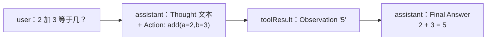

> 基于 [earendil-works/pi](https://github.com/earendil-works/pi) **commit `a758f3a`（2026-11-03 读取）**；示例使用 npm 上的 `@earendil-works/pi-agent-core@1.5.0`、`@earendil-works/pi-ai@1.5.0`（与该 commit 中 `package.json` 的版本号一致）。代码摘录按 MIT 许可引用。

**本篇重点**：前五篇读懂了原理，这篇亲手跑起来。我们**不需要任何 API Key**：用 pi-ai 自带的 faux（假）provider 脚本化模型回复，真实运行 Agent 循环，观察事件序列，再用 `beforeToolCall` 做一次权限拦截。最后把它和 ReAct、Function Calling 概念对上号。

<!-- more -->

## 人话直觉

学 Agent 最大的门槛往往是「得先有个能用的 API Key」，而且真实模型每次输出都不一样，不方便观察。faux provider 就像「演员照剧本念台词」：我们规定第一轮模型说「我先算一下」并调用 `add` 工具，第二轮说「2 + 3 = 5」。**模型是假的，但 Agent 循环、工具校验与执行、事件、状态全是真的 Pi 代码**。

## 准备

需要 Node.js（我用的是 v24）：

```bash
mkdir pi-demo && cd pi-demo
npm init -y
npm i @earendil-works/pi-agent-core@1.5.0 @earendil-works/pi-ai@1.5.0 @earendil-works/pi-schema
```

## 完整代码 demo.mjs

```js
import { Agent } from "@earendil-works/pi-agent-core";
import { createModels, fauxProvider, fauxAssistantMessage, fauxText, fauxToolCall } from "@earendil-works/pi-ai";
import { obj, num } from "@earendil-works/pi-schema";

const faux = fauxProvider();
const models = createModels();
models.setProvider(faux.provider);

// 脚本化两轮回复：第 1 轮调用工具，第 2 轮给出最终答案
faux.setResponses([
  fauxAssistantMessage([fauxText("我先算一下。"), fauxToolCall("add", { a: 2, b: 3 })], { stopReason: "toolUse" }),
  fauxAssistantMessage([fauxText("2 + 3 = 5")]),
]);

const addTool = {
  name: "add",
  label: "Add",
  description: "Add two numbers",
  parameters: obj({ a: num(), b: num() }),
  async execute(_id, { a, b }) {
    return { content: [{ type: "text", text: String(a + b) }], details: { a, b } };
  },
};

const agent = new Agent({
  initialState: { systemPrompt: "You are a calculator.", model: faux.getModel(), tools: [addTool] },
  streamFn: models.streamSimple.bind(models),
});

agent.subscribe((e) => {
  if (e.type === "message_update") return;
  const extra = e.type === "message_end" ? ` role=${e.message.role}` :
    e.type.startsWith("tool_execution") ? ` tool=${e.toolName}` : "";
  console.log(e.type + extra);
});

await agent.prompt("2 加 3 等于几？");
console.log("---- transcript roles:", agent.state.messages.map((m) => m.role).join(", "));
const last = agent.state.messages.at(-1);
console.log("---- final:", last.content.filter((c) => c.type === "text").map((c) => c.text).join(""));
```

逐段讲：

1. **`fauxProvider()` + `createModels()` + `setProvider()`**：注册一个假厂商（第 2 篇）。`faux.setResponses([...])` 排好两轮回复；第一轮 `stopReason: "toolUse"`，内容含 `fauxToolCall("add", { a: 2, b: 3 })`。
2. **工具 `addTool`**：就是第 3 篇的 `AgentTool` 形状——`name`、`label`、`description`、`parameters`（用 pi-schema 的 `obj/num` 构建 JSON Schema）、`execute`。返回值分 `content`（给模型）和 `details`（给 UI）。
3. **`new Agent({ initialState, streamFn })`**：`streamFn` 用 `models.streamSimple.bind(models)`——这正是 pi-agent-core README 里的写法，也是第 1 篇说的「依赖倒置插槽」。`systemPrompt` 和 `tools` 会变成首条 system 消息（`createMutableAgentState`）。
4. **`agent.subscribe`**：打印除 `message_update`（流式增量，太多）以外的所有事件。
5. **`await agent.prompt(...)`**：跑完整个循环才返回。

## 真实运行输出

`node demo.mjs`（2026-11-03 在本地实际运行，原样粘贴）：

```text
agent_start
turn_start
message_start
message_end role=user
message_start
message_end role=assistant
tool_execution_start tool=add
tool_execution_end tool=add
message_start
message_end role=toolResult
turn_end
turn_start
message_start
message_end role=assistant
turn_end
agent_end
---- transcript roles: system, user, assistant, toolResult, assistant
---- final: 2 + 3 = 5
```

对照第 3 篇的 `runLoop` 读这段输出：

- `agent_start`、`turn_start`、用户消息的 `message_start/end`：来自 `runAgentLoop` 开头。
- 第一个 `assistant` 消息：`streamAssistantResponse` 产生，里面有 toolCall。
- `tool_execution_start/end` + `toolResult` 的 `message_start/end`：来自 `executeToolCallsParallel` → `emitToolExecutionEnd` → `emitToolResultMessage`。
- `turn_end` 后 `hasMoreToolCalls` 为真 → 第二个 `turn_start`（来自 `lastCompletedTurn` 分支）。
- 第二轮模型没有工具调用 → 内层循环结束 → follow-up 队列为空 → `agent_end`。
- 最终对话记录是 `system, user, assistant, toolResult, assistant`：第一条 `system` 就是由 `systemPrompt` + `tools` 生成的首条系统消息。

## 实验二：用 beforeToolCall 拦截工具

在 `new Agent({...})` 里加一个钩子（其余不变，第二轮台词改成「工具被拦截了」）：

```js
beforeToolCall: async ({ toolCall, args }) =>
  (args.a > 1 ? { block: true, reason: "a 太大，拒绝执行" } : undefined),
```

实际运行后打印出的 toolResult 消息（原样，仅 id 和时间戳是每次运行生成的）：

```json
{"role":"toolResult","toolCallId":"tool:1793711454111:2l4mp4lactu","toolName":"add","content":[{"type":"text","text":"a 太大，拒绝执行"}],"details":{},"isError":true,"timestamp":1793711454124}
```

正如第 3 篇 `prepareToolCall` 源码所示：被拦截时 `execute` 根本不会运行，生成 `isError: true` 的结果，内容就是 `reason`。这就是 coding-agent 里扩展 `tool_call` 拦截（第 5 篇）的底层机制。

## 换成真实模型

把 faux 换成真实 provider 只改几行。下面写法来自 pi-ai README（我**没有**在本地用真实 Key 运行过，所以这里不给输出）：

```js
import { builtinModels } from "@earendil-works/pi-ai/providers/all";
const models = builtinModels();
const model = models.getModel("openai", "gpt-4o-mini"); // README 示例中的模型 id
// 认证从环境变量解析（README：OPENAI_API_KEY）
const agent = new Agent({ initialState: { systemPrompt: "...", model, tools: [addTool] }, streamFn: models.streamSimple.bind(models) });
```

想要读写文件、跑命令的完整编程助手，用 coding-agent 的 SDK：`createAgentSession()`（第 5 篇）。

## 和 ReAct / Function Calling 对应起来

本博客的 [AI Agent 与工具调用：ReAct、Function Calling、MCP 入门](/2026/10/29/ai-agent-tool-calling/) 讲过概念，现在一一落到 Pi 源码上：

| 概念 | Pi 里对应的东西 |
|---|---|
| Function Calling 的「函数声明」 | `Tool { name, description, parameters }`（pi-ai `types.ts`），由 system 消息的 `toolsAdded` 发给模型 |
| 模型「决定调用函数」 | 助手消息 `content` 里的 `ToolCall` 块，`stopReason: "toolUse"` |
| 执行函数并把结果回传 | `executeToolCalls` → `ToolResultMessage`（`toolCallId` 对应调用 id） |
| ReAct 的 Thought | 助手消息里的 `text`（"我先算一下。"）或 `thinking` 块 |
| ReAct 的 Action | `ToolCall` |
| ReAct 的 Observation | `toolResult` 消息 |
| ReAct 的循环直到 Final Answer | `runLoop` 内层循环：无工具调用时结束 |

**需要说明的区别**：ReAct 论文原始做法是让模型用文本格式（Thought/Action/Observation）输出、由程序解析；Pi 这类现代框架使用模型厂商原生的结构化工具调用接口，「Action」是结构化的 `ToolCall`，不需要解析文本。思想相同，实现方式不同。



## 设计取舍

- **faux provider 做测试**：确定性强、免费、可测错误路径（队列空了会返回错误消息）；但测不到真实模型的「不听话」，所以 edit 工具的 `prepareArguments` 这类兼容逻辑要靠真实模型的经验积累。
- **用 agent-core 还是 coding-agent SDK**：前者轻量、完全可控，适合做自己的 Agent 产品；后者开箱有工具、会话、压缩、扩展，适合直接复用编程助手能力。

## 常见误区

- ❌「没有 API Key 就学不了 Agent」——用假 provider 就能跑通真实循环。
- ❌「`prompt()` 返回时只调用了一次模型」——上面的输出清楚显示两个 turn。
- ❌「ReAct 和 Function Calling 是两个对立的东西」——Function Calling 是实现 ReAct 中 Action 的一种结构化接口。

## 面试问答

1. **问：手写一个最小 Agent 需要哪些部件？**
   答：模型调用（流式）、消息历史、工具定义与执行、循环与终止条件、错误处理；可选钩子、事件、中止。
2. **问：怎么给 Agent 写单元测试？**
   答：注入假模型（脚本化回复，含工具调用与错误），断言事件序列、工具调用参数和最终消息；Pi 的 faux provider 就是为此设计的。
3. **问：ReAct 与原生 Function Calling 的关系？**
   答：ReAct 是「推理-行动-观察」的范式；原生 Function Calling 是让 Action 结构化、免解析的 API 能力，两者常结合。
4. **问：一次 `prompt()` 中事件的大致顺序？**
   答：agent_start → turn_start → user message → assistant message →（tool_execution_* → toolResult message）→ turn_end →（下一轮…）→ agent_end。
5. **问：工具被拒绝后，模型怎么知道？**
   答：收到一条 `isError: true` 的工具结果，内容是拒绝原因，模型可据此换方案或向用户解释。

## 自测题

1. 把 `faux.setResponses` 里第二条回复删掉，运行会发生什么？
2. 想让 `add` 工具每次只能单独执行（不与其他工具并行），怎么改？
3. 输出里为什么第一条消息是 `system`？

<details><summary>答案</summary>

1. 第二轮请求时队列为空，faux provider 返回 `errorMessage: "No more faux responses queued"` 的错误消息（README 说明），循环因 `stopReason: "error"` 结束。（我实际运行过这个变体：最后一条消息 `stopReason` 为 `"error"`，`errorMessage` 为 `"No more faux responses queued"`。）
2. 给工具加 `executionMode: "sequential"`。
3. `initialState` 的 `systemPrompt` 和 `tools` 被 `createMutableAgentState` 转成首条 system 消息。
</details>

## 参考资料

- pi-agent-core README：https://github.com/earendil-works/pi/blob/a758f3ae4cdb193a6949c81318fe1b3caa4814a1/packages/agent/README.md
- pi-ai README（Quick Start、Faux Provider 小节）：https://github.com/earendil-works/pi/blob/a758f3ae4cdb193a6949c81318fe1b3caa4814a1/packages/ai/README.md
- `packages/agent/src/agent.ts`、`agent-loop.ts`；`packages/ai/src/providers/faux.ts`
- ReAct 论文：Yao et al., *ReAct: Synergizing Reasoning and Acting in Language Models*, https://arxiv.org/abs/2210.03629
- 本博客：[AI Agent 与工具调用：ReAct、Function Calling、MCP 入门](/2026/10/29/ai-agent-tool-calling/)

**系列目录**：[（一）总览](/2026/11/03/pi-source-01-overview/) · [（二）pi-ai](/2026/11/03/pi-source-02-pi-ai/) · [（三）Agent 主循环](/2026/11/03/pi-source-03-agent-loop/) · [（四）编程助手工具与会话](/2026/11/03/pi-source-04-coding-agent/) · [（五）扩展与运行模式](/2026/11/03/pi-source-05-extensions-modes/) · [（六）动手写最小 Agent](/2026/11/03/pi-source-06-hands-on/)
